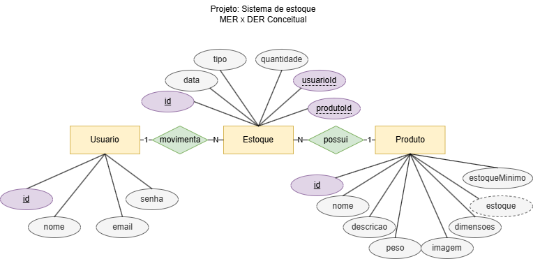
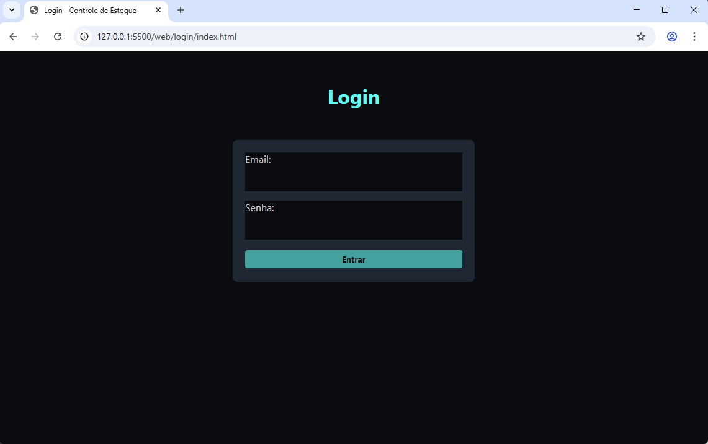
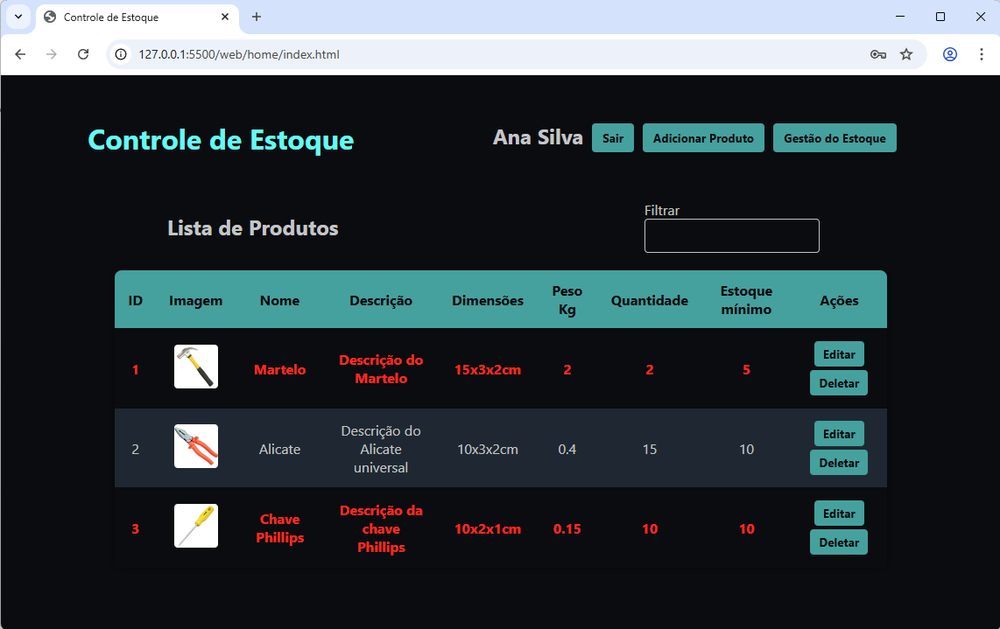
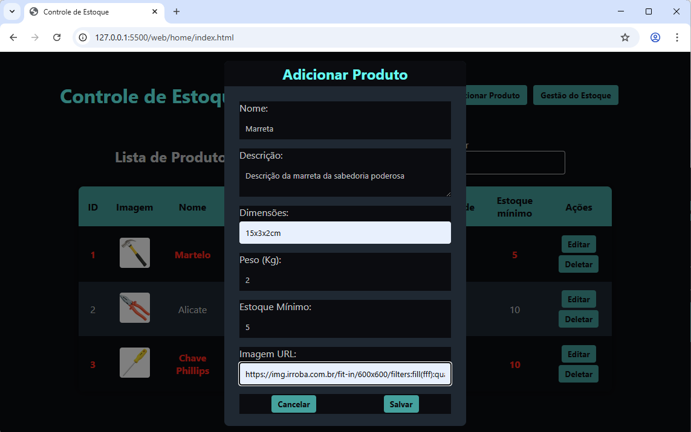
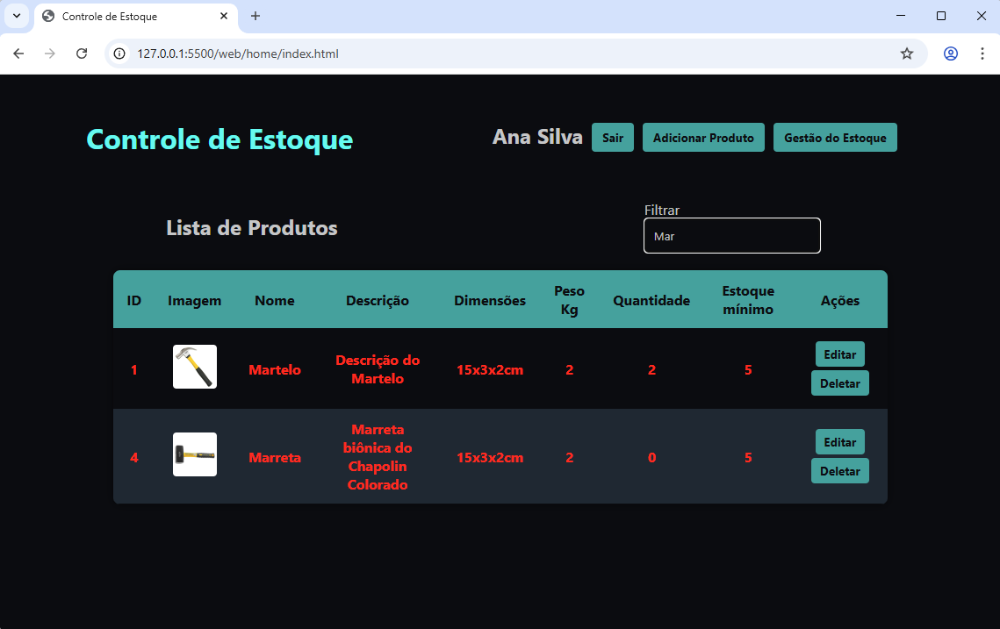
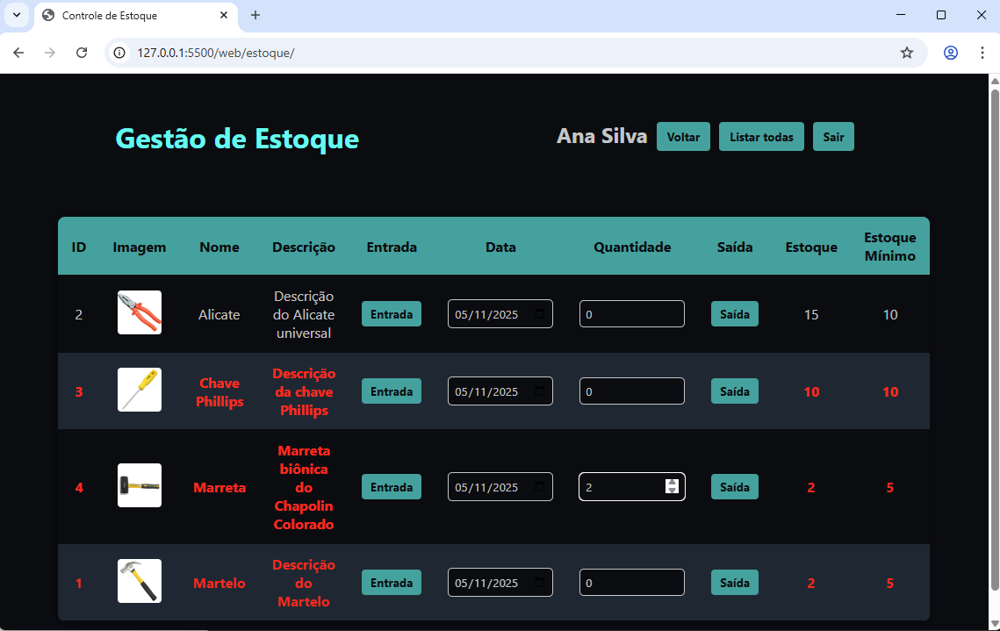
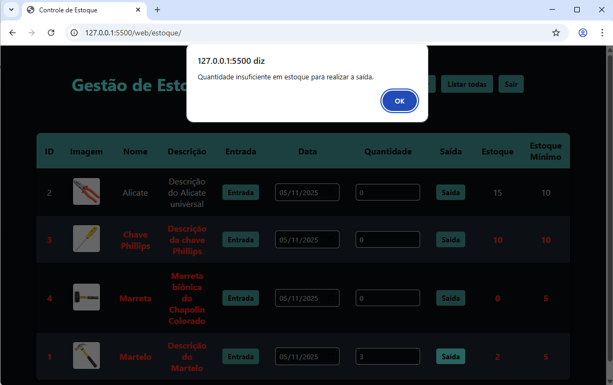
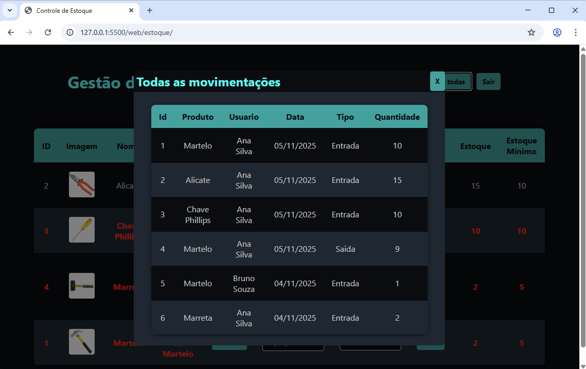

# Controle de estoque
Sistema para controle de estoque desenvolvido em Node.js com banco de dados MySQL (MariaDB) e UI HTML/CSS/JavaScript.

## 1 [Lista de requisitos funcionais](./docs/requisitos_funcionais.md)
## Diagrama de Entidade e Relacionamentos

## 2 Script de criação e população do banco de dados
- [Script de criação - prisma/schema.prisma](./api/prisma/schema.prisma)
- [Script de população - prisma/seed.js](./api/prisma/seed.js)
## 3 Interface de autenticação de usuários (login)

## 4 Interface principal do sistema

## 5 Interface cadastro de produto

## 6 Interface gestão de estoque

## 7 [Descritivo de teste de software](./docs/teste-software.md)
## 8 Lista de requisitos de infraestrutura
- Node.js (JavaScript Runtime)
- MySQL (MariaDB) - XAMPP
- VsCode (IDE)
- HTML, CSS e JavaScript
