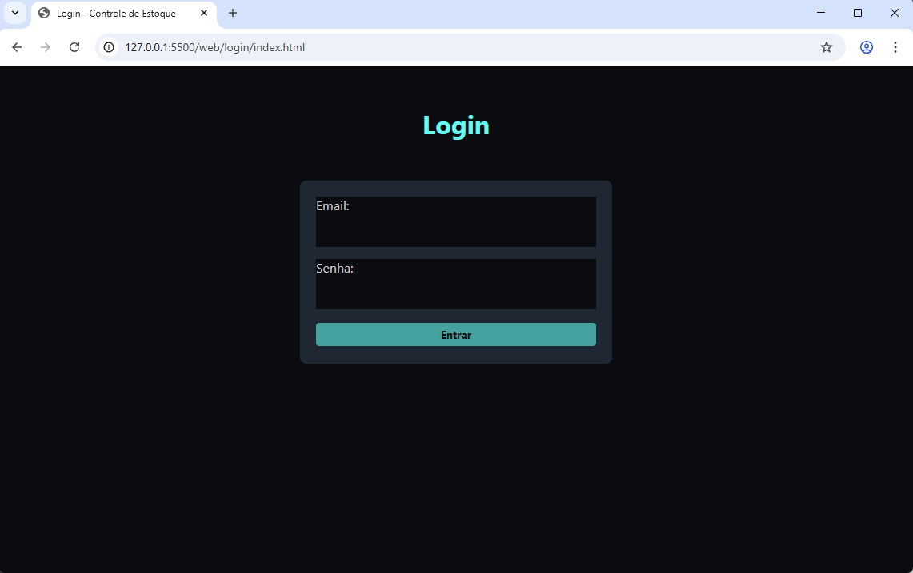
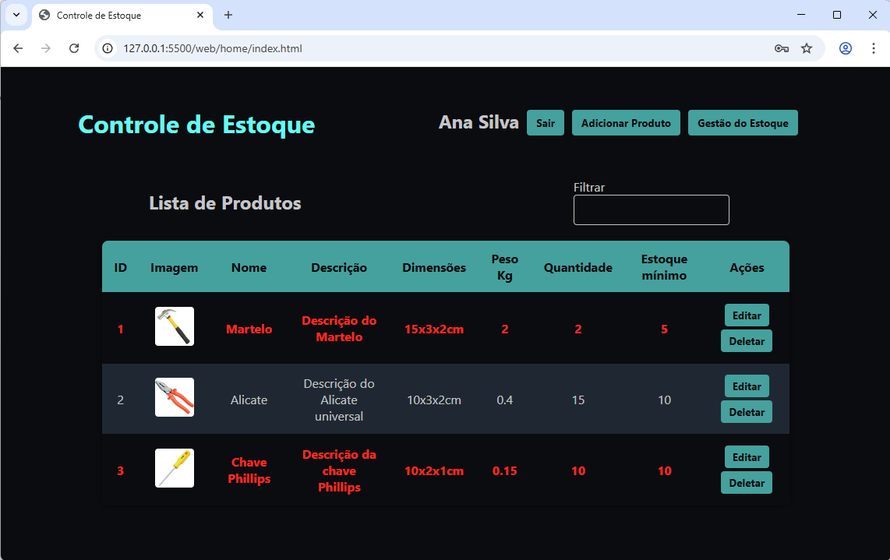
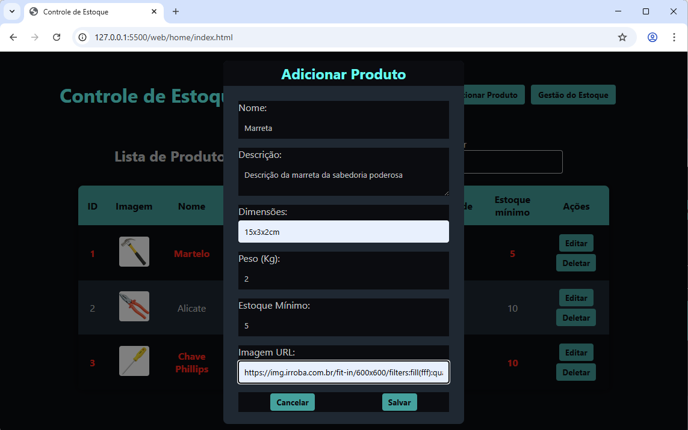
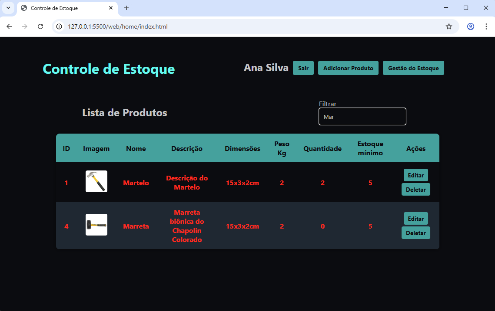
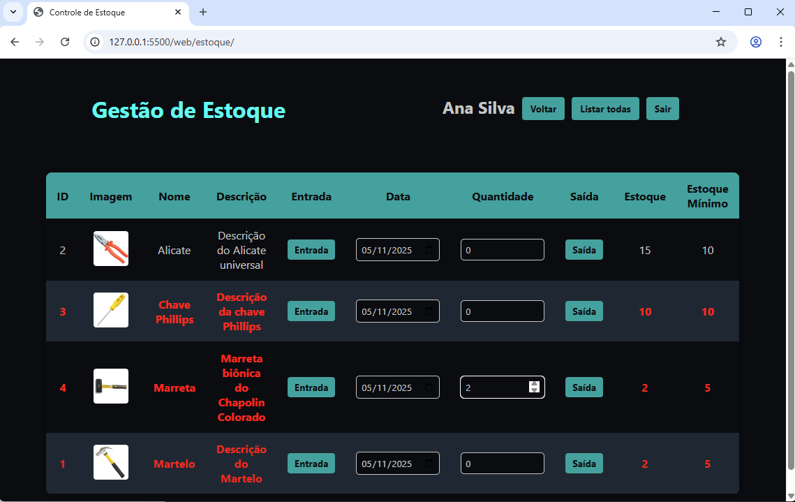
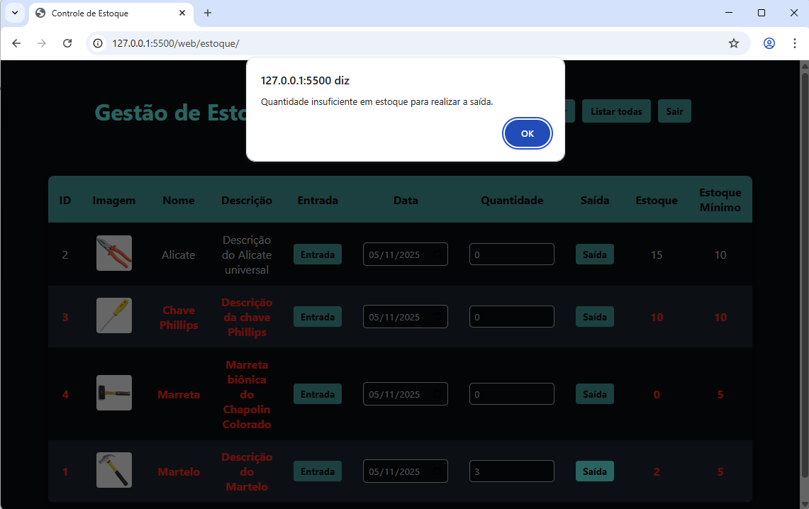
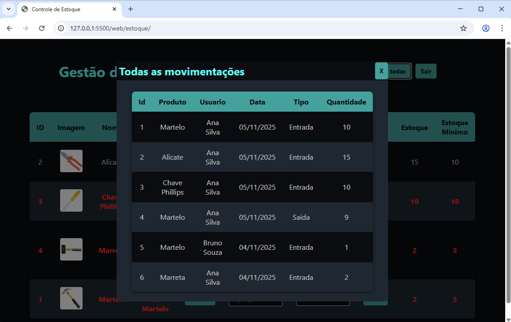

#  Descritivo de teste de software

- [X] O sistema deve permitir autenticação por usuário cadastrado.
    - [X] O usuário deve possuir os campos email, senha e nome completo.
    - [X] O sistema deve validar o email e senha no momento do login.
    - [X] O sistema deve fazer o logout do usuário autenticado.
 
- [X] O sistema deve permitir o cadastro de produtos.
    - [X] O produto deve possuir os campos nome, descrição, peso, dimensões, imagem e estoque mínimo.
    - [X] Ao listar os produtos, o sistema deve exibir o nome, descrição, imagem e estoque disponível, caso esteja abaixo do estoque mínimo deve exibir um alerta visual.
    - [X] O sistema deve permitir a atualização e exclusão de produtos cadastrados.
    - [X] A interface deve permitir a busca de produtos digitando em um campo.
 
 
 
- [X] O sistema deve permitir que o usuário registre a movimentação do produto no **estoque** em `Entradas` e `Saídas`.
    - [X] A movimentação deve possuir os campos produto, quantidade, tipo de movimentação (entrada ou saída), data da movimentação e qual o usuário que realizou a movimentação.
    - [X] O sistema deve atualizar o estoque do produto conforme a movimentação registrada.
    - [X] O sistema deve impedir que o estoque do produto fique negativo.
 
 
 
 