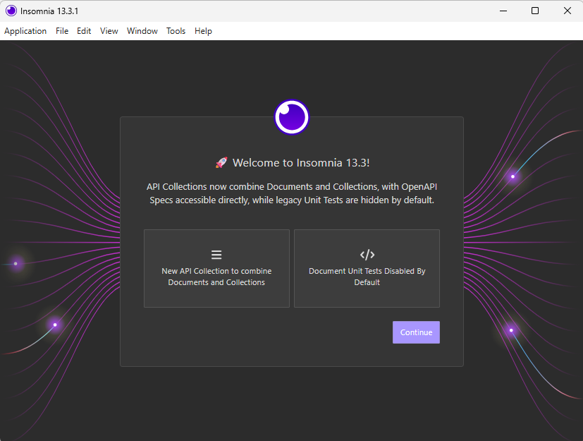
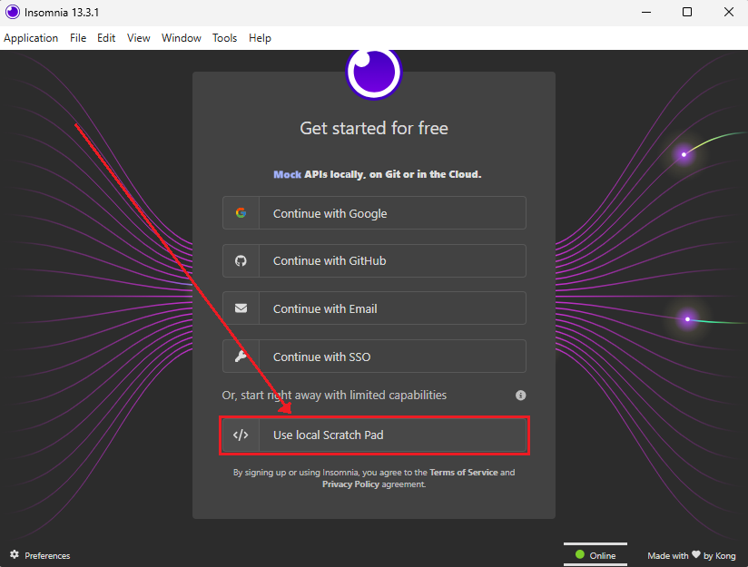
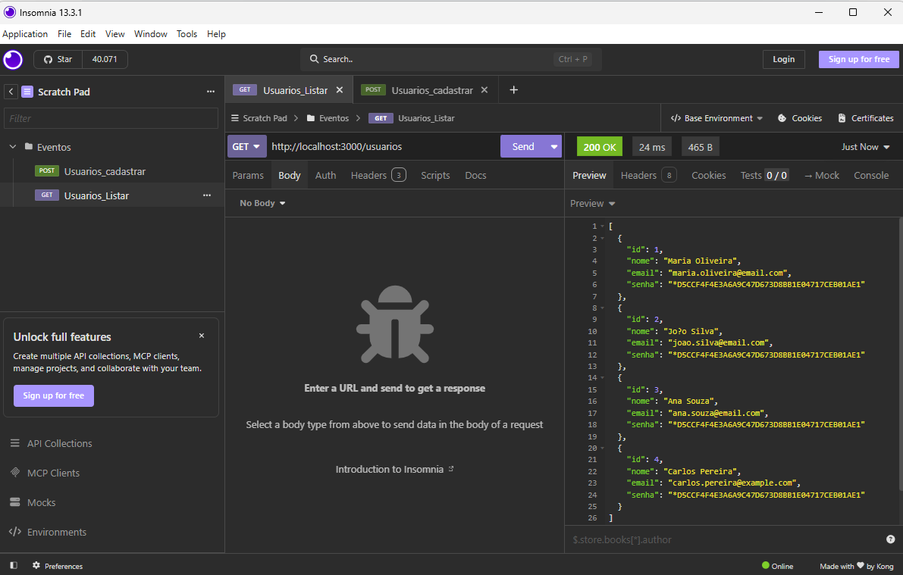
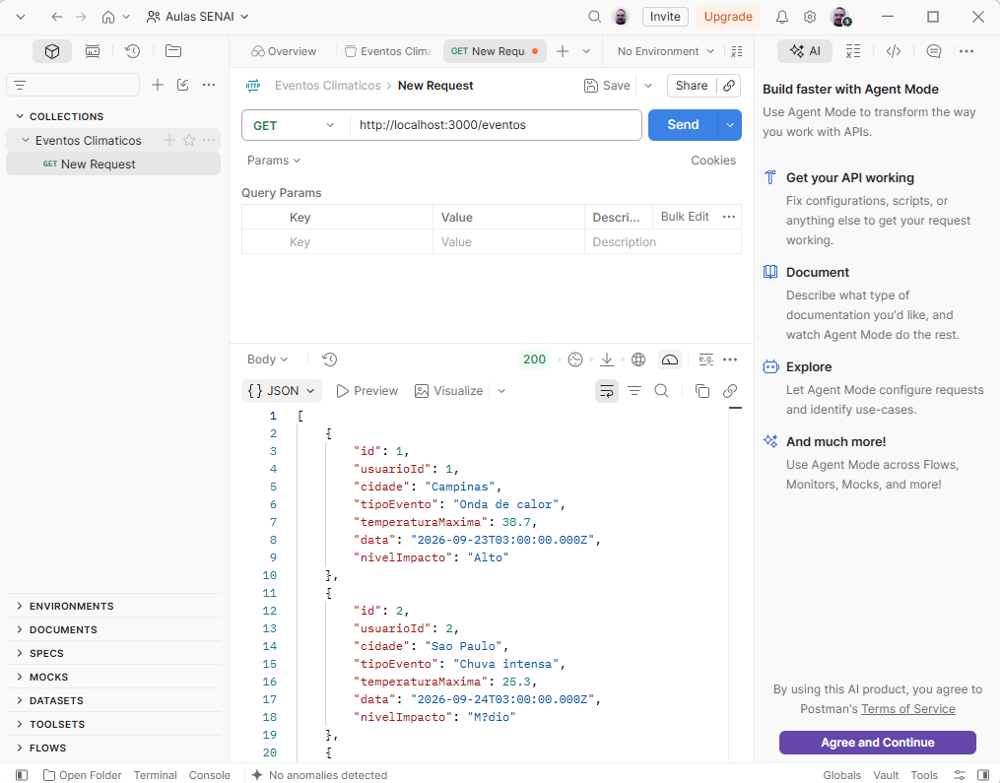

# Aula09 - Conexão com Banco de Dados
- SGBD: Sistema de Gerenciamento de Banco de Dados
- MariaDB: Sistema de Gerenciamento de Banco de Dados relacional, derivado do MySQL.
- Node.js: Ambiente de execução JavaScript, que permite a execução de código JavaScript fora do navegador.

## Objetivo
Conectar o back-end da aplicação web com um banco de dados relacional, utilizando o SGBD MariaDB e a linguagem de programação JavaScript com Node.js.
### Capacidades Técnicas
- 1 Utilizar o paradigma da programação orientada a objetos
- 2 Elaborar diagramas de classe
- 5 Preparar o ambiente necessário ao desenvolvimento back-end para a plataforma web
- 6 Definir os elementos de entrada, processamento e saída para a programação da aplicação web
- 7 Utilizar design patterns no desenvolvimento da aplicação web
- 8 Definir os frameworks a serem utilizados no desenvolvimento da aplicação web
- 9 Utilizar interações com base de dados para desenvolvimento de sistemas web
### Conhecimentos
- 8 Persistência de dados
  - 8.1. Conexão com base de dados
  - 8.2. CRUD

## Demonstração prática:
### Sistema: Registro de eventos climáticos
- Duas tabelas:
- Usuários: id, nome, email, senha
- Eventos: id, cidade, tipoEvento, temperaturaMaxima, data, nivelImpacto (Baixo, Médio, Alto), usuarioId (chave estrangeira referenciando a tabela Usuários)

### Exemplo de dados para a tabela Usuários:
```json
[
    {
        "id": 1,
        "nome": "Maria Oliveira",
        "email": "maria.oliveira@email.com",
        "senha": "senha123"
    },
    {
        "id": 2,
        "nome": "João Silva",
        "email": "joao.silva@email.com",
        "senha": "senha123"
    },
    {
        "id": 3,
        "nome": "Ana Souza",
        "email": "ana.souza@email.com",
        "senha": "senha123"
    }
]
```
### Exemplo de dados para a tabela Eventos:
```json
[
    {
        "id": 1,
        "cidade": "Campinas",
        "tipoEvento": "Onda de calor",
        "temperaturaMaxima": 38.7,
        "data": "2026-09-23",
        "nivelImpacto": "Alto",
        "usuarioId": 1
    },
    {
        "id": 2,
        "cidade": "São Paulo",
        "tipoEvento": "Chuva intensa",
        "temperaturaMaxima": 25.3,
        "data": "2026-09-24",
        "nivelImpacto": "Médio",
        "usuarioId": 2
    },
    {
        "id": 3,
        "cidade": "Rio de Janeiro",
        "tipoEvento": "Tempestade",
        "temperaturaMaxima": 30.1,
        "data": "2026-09-25",
        "nivelImpacto": "Alto",
        "usuarioId": 1
    },
    {
        "id": 4,
        "cidade": "Belo Horizonte",
        "tipoEvento": "Seca prolongada",
        "temperaturaMaxima": 35.0,
        "data": "2026-09-26",
        "nivelImpacto": "Alto",
        "usuarioId": 2
    },
    {
        "id": 5,
        "cidade": "Porto Alegre",
        "tipoEvento": "Nevasca",
        "temperaturaMaxima": -2.5,
        "data": "2026-09-27",
        "nivelImpacto": "Médio",
        "usuarioId": 3
    }
]
```
## Atividades práticas:
### 1 Banco de dados relacional
#### Documentação

#### Script SQL
- Crie uma pasta na área de trabalho chamada `eventos_climaticos` e dentro dela crie uma outra pasta chamada `db`.
- Na pasta `db`, criar um script para chamado `script.sql` para:
    - criar um banco de dados chamado `registos_climaticos` (DDL)
    - e popular com os dados fornecidos para as tabelas `Usuários` e `Eventos` (DML).
```sql
drop database if exists registros_climaticos;
create database registros_climaticos;
use registros_climaticos;
-- DDL para criar as tabelas do banco de dados
create table usuario (
    id int not null auto_increment primary key,
    nome varchar(100) not null,
    email varchar(100) not null unique,
    senha varchar(100) not null
);

create table evento (
    id int not null auto_increment primary key,
    usuarioId int not null,
    cidade varchar(100) not null,
    tipoEvento varchar(100) not null,
    temperaturaMaxima decimal(10,2) not null,
    data date not null,
    nivelImpacto enum('Baixo', 'Médio', 'Alto') default 'Médio' not null
);

alter table evento add
constraint fk_registra foreign key (usuarioId) references usuario(id);

-- DML para inserir dados de exemplo nas tabelas
insert into usuario (nome, email, senha) values
('Maria Oliveira', 'maria.oliveira@email.com', password('senha123')),
('João Silva', 'joao.silva@email.com', password('senha123')),
('Ana Souza', 'ana.souza@email.com', password('senha123'));

insert into evento (usuarioId, cidade, tipoEvento, temperaturaMaxima, data, nivelImpacto) values
(1, 'Campinas', 'Onda de calor', 38.7, '2026-09-23', 'Alto'),
(2, 'São Paulo', 'Chuva intensa', 25.3, '2026-09-24', 'Médio'),
(1, 'Rio de Janeiro', 'Tempestade', 30.1, '2026-09-25', 'Alto'),
(2, 'Belo Horizonte', 'Seca prolongada', 35.0, '2026-09-26', 'Alto'),
(3, 'Porto Alegre', 'Nevasca', -2.5, '2026-09-27', 'Médio');

select * from usuario;
select * from evento;
```
### 2 Back-end com Node.js
#### Documentação

#### Desenvolvimento JavaScript
- Ainda na pasta `eventos_climaticos`, crie um arquivo `server.js` para implementar o back-end da aplicação web, utilizando Node.js e o framework Express.
    - Crie uma pasta `src` e dentro dela crie uma pasta `controllers` para implementar os controladores da aplicação.
    - crie o arquivo `routes.js` para definir as rotas da aplicação.
    - Crie a seguinte estrutura de pastas e arquivos:
```
eventos_climaticos/
├── db/
│   └── script.sql
├── src/
│   ├── controllers/
│   │   └── evento.js
|   |   └── usuario.js
│   ├── routes.js
└── server.js
```
- Siga este **[tutorial](https://github.com/wellifabio/sesi_pbe1_aula08_pedidos_mvc_uml_dc_2026/blob/main/docs/tutorial_mvc.md)** para implementar o back-end da aplicação web
##### Programando os controllers e rotas
- Após concluir o tutorial e iniciar um novo Back-end MVC, instale a dependência `mysql` para conectar o Node.js com o banco de dados MariaDB.
```bash
npm install mysql
```
- Crie um arquivo de conexão com o banco de dados chamado `db.js` na pasta `src`:
```javascript
const mysql = require('mysql')

const connection = mysql.createConnection({
    host: 'localhost',
    user: 'root',
    database: 'registros_climaticos'
})

module.exports = connection
```
- Edite o arquivo `´src/controllers/usuario.js`
```javascript
const con = require('../db')

const cadastrar = (req, res) => {
    const { nome, email, senha } = req.body
    try {
        const sql = 'INSERT INTO usuario (nome, email, senha) VALUES (?, ?, password(?));'
        con.query(sql, [nome, email, senha], (err, results) => {
            if (err) {
                console.error(err)
                res.status(500).json({ error: 'Erro ao cadastrar usuário' })
            } else {
                const novoUsuario = req.body
                novoUsuario.id = results.insertId
                res.status(201).json({ message: 'Usuário cadastrado com sucesso', user: novoUsuario })
            }
        })
    } catch (error) {
        console.error(error)
        res.status(400).json({ error: 'Erro ao cadastrar usuário', details: 'Informe { nome, email, senha }' })
    }
}

const listar = (req, res) => {
    const sql = 'SELECT * FROM usuario;'
    con.query(sql, (err, results) => {
        if (err) {
            console.error(err)
            res.status(500).json({ error: 'Erro ao buscar usuários' })
        } else {
            res.json(results)
        }
    })
}

module.exports = {
    cadastrar,
    listar
}
```
- Edite o arquivo `src/routes.js` para definir as rotas da aplicação:
```javascript
const express = require("express")
const router = express.Router()

const Usuario = require('./controllers/usuario')

const rotaInicial = (req, res) => {
    res.json("Back-end Eventos Climáticos respondendo")
}

router.get('/',rotaInicial)
router.post('/usuarios', Usuario.cadastrar)
router.get('/usuarios', Usuario.listar)

module.exports = router
```
#### Realizar teste unitário com o Thunder Client
- Instale a extensão **Thunder Client** no VS Code.
- Abra o Thunder Client e crie uma nova requisição POST para cadastrar um usuário:
    - URL: `http://localhost:3000/usuarios`
    - Body (JSON):
```json
{
    "nome": "Carlos Pereira",
    "email": "carlos.pereira@example.com",
    "senha": "senha123"
}
```
- Clique em **Send** e verifique se o usuário foi cadastrado com sucesso.
- Crie uma nova requisição GET para listar todos os usuários:  
    - URL: `http://localhost:3000/usuarios`
- Clique em **Send** e verifique se a lista de usuários é retornada corretamente.

## Atividades
- Implemente os **dois CRUDs listar e cadastrar** para a tabela `evento` seguindo o mesmo padrão utilizado para a tabela `usuario`.
- Mostre o resultado dos testes para o professor, incluindo prints das requisições e respostas do Thunder Client.

## Entrega
- Envie o projeto para o github em um repositorio chamado `sesi_pbe1_aula09_eventos_climaticos_2026`.
    - Crie uma pasta `docs` e dentro dela salve as imagens do MER_DER e do Diagrama de Classes.
    - Crie um README.md com:
        - o título do projeto,
        - descrição (Mostrando o DER e o Diagrama de Classes),
        - tecnologias utilizadas,
        - instruções para testar
        - e prints das requisições e respostas do Thunder Client, salvas em `docs/prints`.
- Mostre o repositorio para o professor **VISTAR**

---

## Desafio - Para a proxima aula
Link do [projeto iniciado na aula anterior](https://github.com/wellifabio/sesi_pbe1_aula09_eventos_climaticos_2026.git) somente com cadastrar e listar das duas classes usuarios e eventos implementadas.
- 1 Implemente os **CRUDs** de `atualizar` e `excluir` para as tabelas `usuario` e `evento`.
- 2 Adicione prints dos testes de atualização e exclusão no README.md do projeto.
- 3 Implemente uma rota `get` de **resumo** e uma funcionalidade de **resumo** que liste todos os eventos e retorne a **média de temperaturas**
- 4 Implemente uma rota `post` de **login** e uma funcionalidade de **login** no conroller `usuario.js` que receba { **email**, **senha** } cadastrados e retorne os dados do usuário se as credenciais forem válidos, se não retorne um erro 404.
- 4 Adicione prints dos testes de login no README.md do projeto.

---

<details>
<summary>
<h2>

[Insomnia](https://insomnia.rest/download)

</h2>
</summary>

Ferramenta de testes, alternativa ao Thunder Client
- Baixe e instale em seu computador
<br>
<br>
<br>

</details>

---

<details>
<summary>
<h2>

[Postman](https://www.postman.com/downloads/)

</h2>
</summary>

Ferramenta de testes, alternativa ao Insomnia
- Se o insomnia não funcinar baixe e instale o Postman, faça login com seu gmail pessoal
- Windows x64
<br>

</details>

---

<details>
<summary>
<h2>Correção</h2>
</summary>

- ser/routes.js
```js
const express = require("express")
const router = express.Router()

const Usuario = require('./controllers/usuario')
const Evento = require('./controllers/evento')

const rotaInicial = (req, res) => {
    res.json("Back-end Eventos Climáticos respondendo")
}

router.get('/',rotaInicial)
router.post('/usuarios/login', Usuario.login)
router.post('/usuarios', Usuario.cadastrar)
router.get('/usuarios', Usuario.listar)
router.put('/usuarios/:id', Usuario.alterar)
router.delete('/usuarios/:id', Usuario.excluir)

router.post('/eventos', Evento.cadastrar)
router.get('/eventos', Evento.listar)
router.patch('/eventos/:id', Evento.alterar)
router.delete('/eventos/:id', Evento.excluir)
router.get('/eventos/resumo', Evento.resumo)

module.exports = router
```
- src/cotrollers/usuario.js
```js
const con = require('../db')

const login = (req, res) => {
    try {
        if (!req.body){
            res.status(400).json("Informe email e senha no corpo da requisição").end();
            return
        }
        const { email, senha } = req.body
        if (email == undefined || senha == undefined){
            res.status(400).json("Informe email e senha").end();
            return
        }
        const sql = 'SELECT id, nome, email FROM usuario WHERE email = ? AND senha = password(?);'
        con.query(sql, [email, senha], (err, results) => {
            if (err) {
                console.error(err)
                res.status(500).json({ erro: 'Erro ao listar usuários' })
            } else {
                if (results.length == 0) {
                    res.status(404).json("Acesso negado, credenciais inválidas")
                } else {
                    res.json(results)
                }
            }
        })
    } catch (e) {
        res.status(500).json({ erro: 'Erro ao conectar com o banco de dados' })
    }
}

const cadastrar = (req, res) => {
    const { nome, email, senha } = req.body
    try {
        const sql = 'INSERT INTO usuario (nome, email, senha) VALUES (?, ?, password(?));'
        con.query(sql, [nome, email, senha], (err, results) => {
            if (err) {
                console.error(err)
                res.status(500).json({ error: 'Erro ao cadastrar usuário' })
            } else {
                const novoUsuario = req.body
                novoUsuario.id = results.insertId
                res.status(201).json({ message: 'Usuário cadastrado com sucesso', user: novoUsuario })
            }
        })
    } catch (error) {
        console.error(error)
        res.status(400).json({ error: 'Erro ao cadastrar usuário', details: 'Informe { nome, email, senha }' })
    }
}

const listar = (req, res) => {
    const sql = 'SELECT * FROM usuario;'
    con.query(sql, (err, results) => {
        if (err) {
            console.error(err)
            res.status(500).json({ error: 'Erro ao buscar usuários' })
        } else {
            res.json(results)
        }
    })
}

const alterar = (req, res) => {
    const { nome, email, senha } = req.body
    try {
        const sql = 'UPDATE usuario SET nome = ?, email = ?, senha = password(?) WHERE id = ?;'
        con.query(sql, [nome, email, senha, Number(req.params.id)], (err, results) => {
            if (err) {
                console.error(err)
                res.status(500).json({ error: 'Erro ao alterar usuário' })
            } else {
                const novoUsuario = req.body
                novoUsuario.id = results.insertId
                res.status(202).json({ message: 'Usuário alterado com sucesso', user: novoUsuario })
            }
        })
    } catch (error) {
        console.error(error)
        res.status(400).json({ error: 'Erro ao alterar usuário', details: 'Informe { nome, email, senha }' })
    }
}

const excluir = (req, res) => {
    const id = Number(req.params.id)
    const sql = 'DELETE FROM usuario WHERE id = ?;'
    con.query(sql, [id], (err, results) => {
        if (err) {
            console.error(err)
            res.status(500).json({ erro: 'Erro ao excluir usuário', msg: err.sqlMessage })
        } else {
            if (results.affectedRows == 1)
                res.json("Registro excluído com sucesso")
            else
                res.status(404).json({ msg: "Nada alerado no banco de dados", erro: results })
        }
    })
}

module.exports = {
    login,
    cadastrar,
    listar,
    alterar,
    excluir
}
```
- src/cotrollers/evento.js
```js
const con = require('../db')

const cadastrar = (req, res) => {
    const { usuarioId, cidade, tipoEvento, temperaturaMaxima, nivelImpacto } = req.body
    try {
        const sql = 'INSERT INTO evento (usuarioId, cidade, tipoEvento, temperaturaMaxima, nivelImpacto) VALUES (?, ?, ?, ?, ?);'
        con.query(sql, [usuarioId, cidade, tipoEvento, temperaturaMaxima, nivelImpacto], (err, results) => {
            if (err) {
                console.error(err)
                res.status(500).json({ error: 'Erro ao cadastrar evento' })
            } else {
                const novoevento = req.body
                novoevento.id = results.insertId
                res.status(201).json({ message: 'Evento cadastrado com sucesso', event: novoevento })
            }
        })
    } catch (error) {
        console.error(error)
        res.status(400).json({ error: 'Erro ao cadastrar evento', details: 'Informe { usuarioId, cidade, tipoEvento, temperaturaMaxima, nivelImpacto }' })
    }
}

const listar = (req, res) => {
    const sql = 'SELECT * FROM evento;'
    con.query(sql, (err, results) => {
        if (err) {
            console.error(err)
            res.status(500).json({ error: 'Erro ao buscar eventos' })
        } else {
            res.json(results)
        }
    })
}

const alterar = (req, res) => {
    const id = Number(req.params.id)
    const chaves = Object.keys(req.body)
    let campos = ''
    const colunas = []
    chaves.forEach((chave) => {
        campos += `${chave} = ?,`
        colunas.push(req.body[chave])
    })
    campos = campos.slice(0, -1) //Remove a ultima virgula
    colunas.push(id)
    const sql = `UPDATE evento SET ${campos} WHERE id = ?;`
    con.query(sql, colunas, (err, results) => {
        if (err) {
            console.error(err)
            res.status(500).json({ erro: 'Erro ao alterar evento', msg: err.sqlMessage })
        } else {
            if (results.affectedRows == 1)
                res.json("Registro alterado com sucesso")
            else
                res.status(404).json({ msg: "Nada alerado no banco de dados", erro: results })
        }
    })
}

const excluir = (req, res) => {
    const id = Number(req.params.id)
    const sql = 'DELETE FROM evento WHERE id = ?;'
    con.query(sql, [id], (err, results) => {
        if (err) {
            console.error(err)
            res.status(500).json({ erro: 'Erro ao excluir evento', msg: err.sqlMessage })
        } else {
            if (results.affectedRows == 1)
                res.json("Registro excluído com sucesso")
            else
                res.status(404).json({ msg: "Nada alerado no banco de dados", erro: results })
        }
    })
}

const resumo = (req, res) => {
    const sql1 = 'SELECT AVG(temperaturaMaxima) as "Temperaturas medias" FROM evento;'
    const sql2 = 'SELECT * FROM evento;'
    con.query(sql1, (err, results) => {
        if (err) {
            console.error(err)
            res.status(500).json({ error: 'Erro ao buscar medias' })
        } else {
            const resposta = {}
            resposta.media = results
            con.query(sql2, (err, results) => {
                if (err) {
                    console.error(err)
                    res.status(500).json({ error: 'Erro ao buscar eventos' })
                }else{
                    resposta.eventos = results
                    res.json(resposta)
                }
            })
        }
    })
}

module.exports = {
    cadastrar,
    listar,
    alterar,
    excluir,
    resumo
}
```

</details>

---

<details>
<summary>
<h2>Correção</h2>
</summary>

- ser/routes.js
```js
const express = require("express")
const router = express.Router()

const Usuario = require('./controllers/usuario')
const Evento = require('./controllers/evento')

const rotaInicial = (req, res) => {
    res.json("Back-end Eventos Climáticos respondendo")
}

router.get('/',rotaInicial)
router.post('/usuarios/login', Usuario.login)
router.post('/usuarios', Usuario.cadastrar)
router.get('/usuarios', Usuario.listar)
router.put('/usuarios/:id', Usuario.alterar)
router.delete('/usuarios/:id', Usuario.excluir)

router.post('/eventos', Evento.cadastrar)
router.get('/eventos', Evento.listar)
router.patch('/eventos/:id', Evento.alterar)
router.delete('/eventos/:id', Evento.excluir)
router.get('/eventos/resumo', Evento.resumo)

module.exports = router
```
- src/cotrollers/usuario.js
```js
const con = require('../db')

const login = (req, res) => {
    try {
        if (!req.body){
            res.status(400).json("Informe email e senha no corpo da requisição").end();
            return
        }
        const { email, senha } = req.body
        if (email == undefined || senha == undefined){
            res.status(400).json("Informe email e senha").end();
            return
        }
        const sql = 'SELECT id, nome, email FROM usuario WHERE email = ? AND senha = password(?);'
        con.query(sql, [email, senha], (err, results) => {
            if (err) {
                console.error(err)
                res.status(500).json({ erro: 'Erro ao listar usuários' })
            } else {
                if (results.length == 0) {
                    res.status(404).json("Acesso negado, credenciais inválidas")
                } else {
                    res.json(results)
                }
            }
        })
    } catch (e) {
        res.status(500).json({ erro: 'Erro ao conectar com o banco de dados' })
    }
}

const cadastrar = (req, res) => {
    const { nome, email, senha } = req.body
    try {
        const sql = 'INSERT INTO usuario (nome, email, senha) VALUES (?, ?, password(?));'
        con.query(sql, [nome, email, senha], (err, results) => {
            if (err) {
                console.error(err)
                res.status(500).json({ error: 'Erro ao cadastrar usuário' })
            } else {
                const novoUsuario = req.body
                novoUsuario.id = results.insertId
                res.status(201).json({ message: 'Usuário cadastrado com sucesso', user: novoUsuario })
            }
        })
    } catch (error) {
        console.error(error)
        res.status(400).json({ error: 'Erro ao cadastrar usuário', details: 'Informe { nome, email, senha }' })
    }
}

const listar = (req, res) => {
    const sql = 'SELECT * FROM usuario;'
    con.query(sql, (err, results) => {
        if (err) {
            console.error(err)
            res.status(500).json({ error: 'Erro ao buscar usuários' })
        } else {
            res.json(results)
        }
    })
}

const alterar = (req, res) => {
    const { nome, email, senha } = req.body
    try {
        const sql = 'UPDATE usuario SET nome = ?, email = ?, senha = password(?) WHERE id = ?;'
        con.query(sql, [nome, email, senha, Number(req.params.id)], (err, results) => {
            if (err) {
                console.error(err)
                res.status(500).json({ error: 'Erro ao alterar usuário' })
            } else {
                const novoUsuario = req.body
                novoUsuario.id = results.insertId
                res.status(202).json({ message: 'Usuário alterado com sucesso', user: novoUsuario })
            }
        })
    } catch (error) {
        console.error(error)
        res.status(400).json({ error: 'Erro ao alterar usuário', details: 'Informe { nome, email, senha }' })
    }
}

const excluir = (req, res) => {
    const id = Number(req.params.id)
    const sql = 'DELETE FROM usuario WHERE id = ?;'
    con.query(sql, [id], (err, results) => {
        if (err) {
            console.error(err)
            res.status(500).json({ erro: 'Erro ao excluir usuário', msg: err.sqlMessage })
        } else {
            if (results.affectedRows == 1)
                res.json("Registro excluído com sucesso")
            else
                res.status(404).json({ msg: "Nada alerado no banco de dados", erro: results })
        }
    })
}

module.exports = {
    login,
    cadastrar,
    listar,
    alterar,
    excluir
}
```
- src/cotrollers/evento.js
```js
const con = require('../db')

const cadastrar = (req, res) => {
    const { usuarioId, cidade, tipoEvento, temperaturaMaxima, nivelImpacto } = req.body
    try {
        const sql = 'INSERT INTO evento (usuarioId, cidade, tipoEvento, temperaturaMaxima, nivelImpacto) VALUES (?, ?, ?, ?, ?);'
        con.query(sql, [usuarioId, cidade, tipoEvento, temperaturaMaxima, nivelImpacto], (err, results) => {
            if (err) {
                console.error(err)
                res.status(500).json({ error: 'Erro ao cadastrar evento' })
            } else {
                const novoevento = req.body
                novoevento.id = results.insertId
                res.status(201).json({ message: 'Evento cadastrado com sucesso', event: novoevento })
            }
        })
    } catch (error) {
        console.error(error)
        res.status(400).json({ error: 'Erro ao cadastrar evento', details: 'Informe { usuarioId, cidade, tipoEvento, temperaturaMaxima, nivelImpacto }' })
    }
}

const listar = (req, res) => {
    const sql = 'SELECT * FROM evento;'
    con.query(sql, (err, results) => {
        if (err) {
            console.error(err)
            res.status(500).json({ error: 'Erro ao buscar eventos' })
        } else {
            res.json(results)
        }
    })
}

const alterar = (req, res) => {
    const id = Number(req.params.id)
    const chaves = Object.keys(req.body)
    let campos = ''
    const colunas = []
    chaves.forEach((chave) => {
        campos += `${chave} = ?,`
        colunas.push(req.body[chave])
    })
    campos = campos.slice(0, -1) //Remove a ultima virgula
    colunas.push(id)
    const sql = `UPDATE evento SET ${campos} WHERE id = ?;`
    con.query(sql, colunas, (err, results) => {
        if (err) {
            console.error(err)
            res.status(500).json({ erro: 'Erro ao alterar evento', msg: err.sqlMessage })
        } else {
            if (results.affectedRows == 1)
                res.json("Registro alterado com sucesso")
            else
                res.status(404).json({ msg: "Nada alerado no banco de dados", erro: results })
        }
    })
}

const excluir = (req, res) => {
    const id = Number(req.params.id)
    const sql = 'DELETE FROM evento WHERE id = ?;'
    con.query(sql, [id], (err, results) => {
        if (err) {
            console.error(err)
            res.status(500).json({ erro: 'Erro ao excluir evento', msg: err.sqlMessage })
        } else {
            if (results.affectedRows == 1)
                res.json("Registro excluído com sucesso")
            else
                res.status(404).json({ msg: "Nada alerado no banco de dados", erro: results })
        }
    })
}

const resumo = (req, res) => {
    const sql1 = 'SELECT AVG(temperaturaMaxima) as "Temperaturas medias" FROM evento;'
    const sql2 = 'SELECT * FROM evento;'
    con.query(sql1, (err, results) => {
        if (err) {
            console.error(err)
            res.status(500).json({ error: 'Erro ao buscar medias' })
        } else {
            const resposta = {}
            resposta.media = results
            con.query(sql2, (err, results) => {
                if (err) {
                    console.error(err)
                    res.status(500).json({ error: 'Erro ao buscar eventos' })
                }else{
                    resposta.eventos = results
                    res.json(resposta)
                }
            })
        }
    })
}

module.exports = {
    cadastrar,
    listar,
    alterar,
    excluir,
    resumo
}
```

</details>