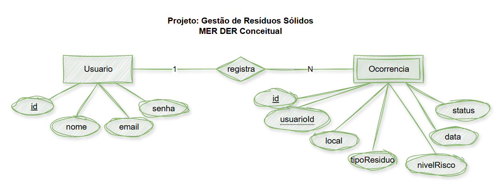
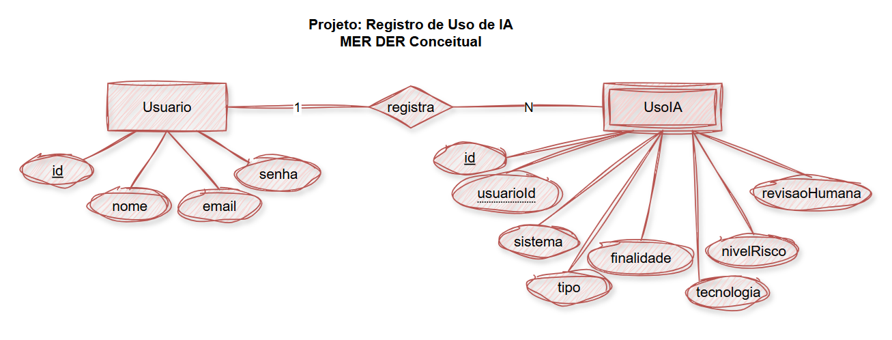
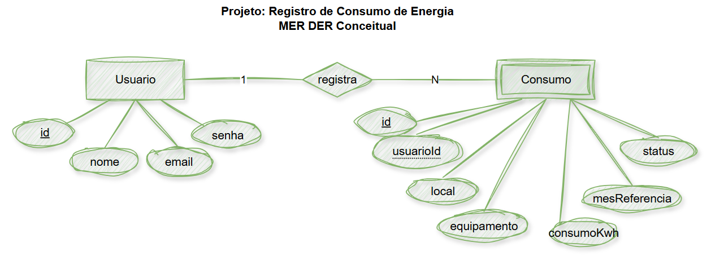

# Aula10 - Situações de Aprendizagem: CRUD Node.js x SGBD

## Objetivo
Conectar o **Node.js** back-end da aplicação web com o **SGBD MariaDB** utilizando a linguagem de programação *JavaScript*.
### Capacidades Técnicas
- 1 Utilizar o paradigma da programação orientada a objetos
- 2 Elaborar diagramas de classe
- 5 Preparar o ambiente necessário ao desenvolvimento back-end para a plataforma web
- 6 Definir os elementos de entrada, processamento e saída para a programação da aplicação web
- 7 Utilizar design patterns no desenvolvimento da aplicação web
- 8 Definir os frameworks a serem utilizados no desenvolvimento da aplicação web
- 9 Utilizar interações com base de dados para desenvolvimento de sistemas web
### Conhecimentos
- 8 Persistência de dados
  - 8.1. Conexão com base de dados
  - 8.2. CRUD

---

## Situação 01 - Gestão de resíduos Sólidos
### Contextualização
A prefeitura de Amparo necessita realizar o Monitoramento de pontos de descarte irregular, para isso desenvolva um sistema para registrar locais onde foram identificados descartes de lixo, entulho ou resíduos eletrônicos.
<br>

### Desafio
Crie uma pasta em sua área de trabalho chamada `backend_residuos` e abra com o **VsCode**
- Dentro dela crie uma pasta chamada `docs` e salve o MER DER da imagem acima
- Crie uma outra pasta chamada `db` e um arquivo chamado `db/script.sql` contendo o seguinte script de criação e população do banco de dados:
```sql
drop database if exists gestao_residuos;
create database gestao_residuos;
use gestao_residuos;
-- DDL Criação das tabelas
create table usuario (
    id int not null auto_increment primary key,
    nome varchar(100) not null,
    email varchar(100) not null unique,
    senha varchar(100) not null
);
create table ocorrencia (
    id int not null auto_increment primary key,
    usuarioId int not null,
    local varchar(100) not null,
    tipoResiduo varchar(50) not null,
    nivelRisco enum('Baixo', 'Medio', 'Alto') default('Medio') not null,
    data Date default(curdate()) not null,
    status enum('Novo', 'Tratado', 'Pendente') default('Novo') not null
);
alter table ocorrencia add constraint fk_registra
foreign key (usuarioId) references usuario(id);

-- DML para inserir dados de exemplo nas tabelas
insert into usuario (nome, email, senha) values
('Maria Oliveira', 'maria.oliveira@email.com', password('senha123')),
('João Silva', 'joao.silva@email.com', password('senha123')),
('Ana Souza', 'ana.souza@email.com', password('senha123'));

insert into ocorrencia(usuarioId, local, tipoResiduo, nivelRisco, status) values
(1, 'Avenida Osmar Contato, 120', 'Eletrônico', 'Alto', 'Novo'),
(2, 'Rua Osmar Motta, 1313', 'Veículo usado', 'Baixo', 'Pendente'),
(1, 'Rua Lucas trado, 15', 'Eletônico', 'Alto', 'Tratado'),
(2, 'Rua Rolando da Rocha, S/N', 'Móvel usado', 'Medio', 'Novo'),
(3, 'Rua Osmar Dito, 101', 'Hospitalar', 'Alto', 'Novo');

select * from usuario;
select * from ocorrencia;
show tables;
```
- Ainda na pasta `backend_residuos`, crie o arquivo `server.js` para implementar o back-end.
- Crie a pasta `src` e dentro dela o arquivo `src/routes.js` e o arquivo `db.js`
- Crie a pasta `src/controllers` e os arquivos `usuario.js` e `ocorrencia.js` semelhante a estrutura de arquivos abaixo:
```
backend_residuos/
├── db/
│   └── script.sql
├── docs/
│   └── der_residuos.sql
├── src/
│   ├── controllers/
│   │   └── ocorrencia.js
|   |   └── usuario.js
│   ├── db.js
│   ├── routes.js
└── server.js
```
- Semelhante ao exemplo da aula anterior desenvolva os seguintes requisitos:
#### Requisitos
##### Não funcionais
- [NF001] Utiliando o *draw.io* faça o Diagrama de Classes e salvem como imagem `.PNG` dentro da pasta `./docs`
##### Funcionais
- [RF001] CRUD de usuários
- [RF002] Login
- [RF003] CRUD de resíduos
- [RF004] Resumo contendo a **contagem total** de resíduos **tratatos**

---

## Situação 02 - Registros de uso de IA
### Contextualização
Um pesquisador da Faculdade de Jauariúna precisa de um banco de dados de registros de usos de Inteligência Artificial
- Um catálogo para registrar como empresas, escolas ou pessoas estão utilizando IA, incluindo finalidade e possíveis riscos.
<br>

### Desafio
Crie uma pasta em sua área de trabalho chamada `backend_usos_ia` e abra com o **VsCode**
- Dentro dela crie uma pasta chamada `docs` e salve o MER DER da imagem acima
- Crie uma outra pasta chamada `db` e um arquivo chamado `db/script.sql` contendo o seguinte script de criação e população do banco de dados:
```sql
drop database if exists usos_ia;
create database usos_ia;
use usos_ia;
-- DDL Criação das tabelas
create table usuario (
    id int not null auto_increment primary key,
    nome varchar(100) not null,
    email varchar(100) not null unique,
    senha varchar(100) not null
);
create table usoia (
    id int not null auto_increment primary key,
    usuarioId int not null
);
alter table usoia add constraint fk_registra
foreign key (usuarioId) references usuario(id);

-- DML para inserir dados de exemplo nas tabelas
insert into usuario (nome, email, senha) values
('Sofia de Paula', 'maria.oliveira@email.com', password('senha123')),
('Paula Silva', 'paula@email.com', password('senha123')),
('Passos Dias Aguiar', 'passos@email.com', password('senha123'));

insert into usoia() values ();

select * from usuario;
select * from usoia;
show tables;
```
- Ainda na pasta `backend_usos_ia`, crie o arquivo `server.js` para implementar o back-end.
- Crie a pasta `src` e dentro dela o arquivo `src/routes.js` e o arquivo `db.js`
- Crie a pasta `src/controllers` e os arquivos `usuario.js` e `usoia.js` semelhante a estrutura de arquivos abaixo:
```
backend_usos_ia/
├── db/
│   └── script.sql
├── docs/
│   └── der_uso_ia.sql
├── src/
│   ├── controllers/
│   │   └── usoia.js
|   |   └── usuario.js
│   ├── db.js
│   ├── routes.js
└── server.js
```
- Semelhante ao exemplo da aula anterior desenvolva os seguintes requisitos:
#### Requisitos
##### Não funcionais
- [NF001] Utiliando o *draw.io* faça o Diagrama de Classes e salvem como imagem `.PNG` dentro da pasta `./docs`
##### Funcionais
- [RF001] CRUD de usuários
- [RF002] Login
- [RF003] CRUD de usoia
- [RF004] Resumo contendo a **contagem total** de níveis de risco **ALto, Médio e Baixo**

---

## Situação 03 - Registro de Consumo de Energia
### Contextualização
O SESI precisa de um sistema para registrar equipamentos ou locais e acompanhar o consumo energético, identificando possíveis desperdícios.
<br>

### Desafio
Crie uma pasta em sua área de trabalho chamada `backend_energia` e abra com o **VsCode**
- Dentro dela crie uma pasta chamada `docs` e salve o MER DER da imagem acima
- Crie uma outra pasta chamada `db` e um arquivo chamado `db/script.sql` contendo o seguinte script de criação e população do banco de dados:
```sql
drop database if exists gestao_residuos;
create database gestao_residuos;
use gestao_residuos;
-- DDL Criação das tabelas
create table usuario (
    id int not null auto_increment primary key,
    nome varchar(100) not null,
    email varchar(100) not null unique,
    senha varchar(100) not null
);
create table consumo (
    id int not null auto_increment primary key,
    usuarioId int not null
);
alter table consumo add constraint fk_registra
foreign key (usuarioId) references usuario(id);

-- DML para inserir dados de exemplo nas tabelas
insert into usuario (nome, email, senha) values
('Jacinto Penna', 'jacinto@email.com', password('senha123')),
('Fujiro Nakombi', 'fujiro@email.com', password('senha123')),
('Lindo Omar', 'lindo@email.com', password('senha123'));

insert into consumo() values ();

select * from usuario;
select * from consumo;
show tables;
```
- Ainda na pasta `backend_energia`, crie o arquivo `server.js` para implementar o back-end.
- Crie a pasta `src` e dentro dela o arquivo `src/routes.js` e o arquivo `db.js`
- Crie a pasta `src/controllers` e os arquivos `usuario.js` e `consumo.js` semelhante a estrutura de arquivos abaixo:
```
backend_energia/
├── db/
│   └── script.sql
├── docs/
│   └── der_energia.sql
├── src/
│   ├── controllers/
│   │   └── consumo.js
|   |   └── usuario.js
│   ├── db.js
│   ├── routes.js
└── server.js
```
- Semelhante ao exemplo da aula anterior desenvolva os seguintes requisitos:
#### Requisitos
##### Não funcionais
- [NF001] Utiliando o *draw.io* faça o Diagrama de Classes e salvem como imagem `.PNG` dentro da pasta `./docs`
##### Funcionais
- [RF001] CRUD de usuários
- [RF002] Login
- [RF003] CRUD de consumo
- [RF004] Resumo contendo a **media de consumo** de energia em **kwh**.