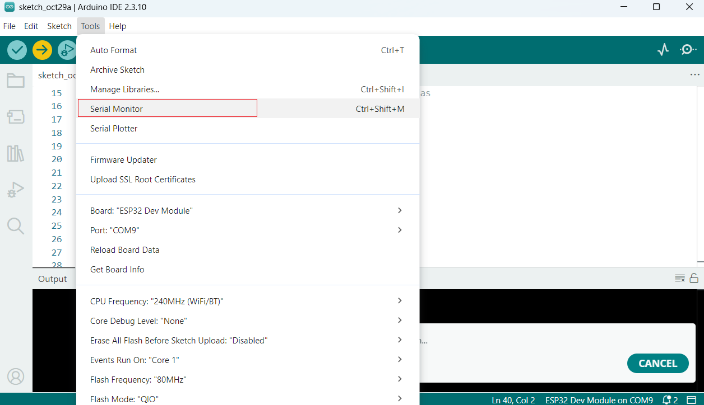
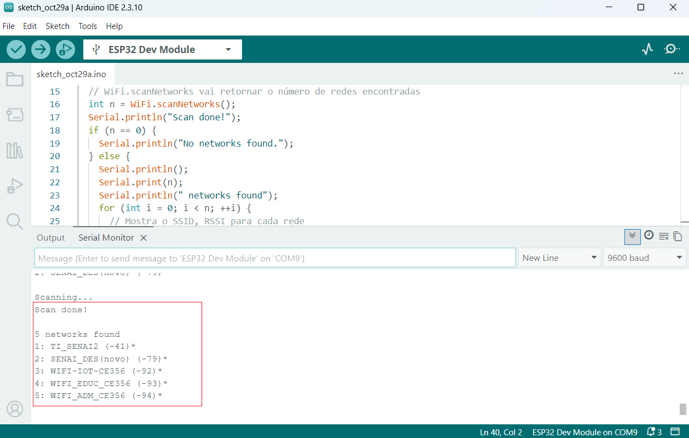
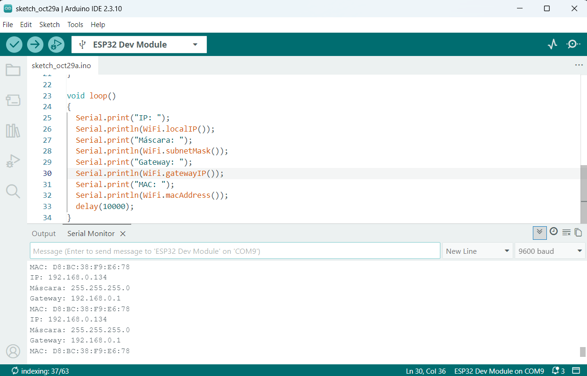
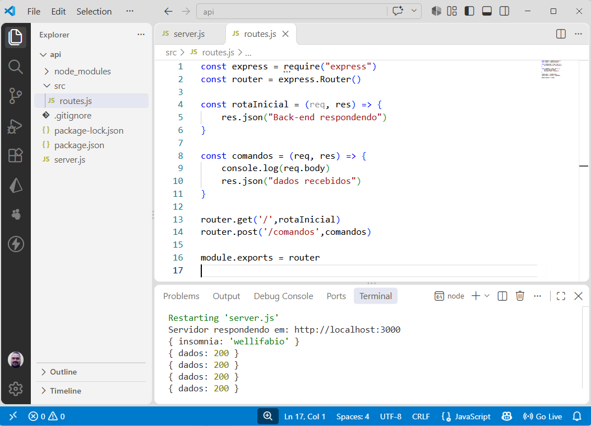
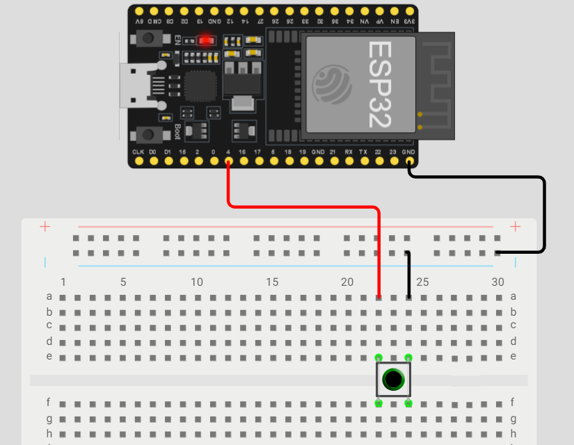
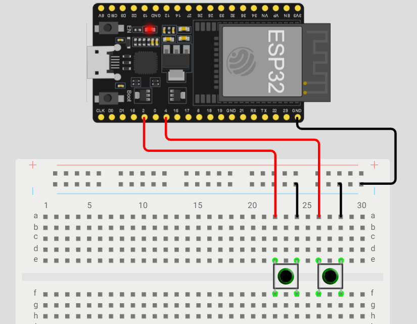

# Aula07 - ESP32 - WIFI

## Trabalhando com WIFI
Vamos verificar os recursos de WiFi da placa ESP32

<details><summary><h3>

Buscando redes com código do [WOKWI](https://wokwi.com/esp32)

</h3></summary>

Acesse o link do simulador acima, clique no primeiro protótipo **WiFi Scanning**
- Altere o número do monitor serial `Serial.begin(115200);` na linha 6 para `Serial.begin(9600);`
- Conecte sua placa ESP32 no computador via USB
- Abra o **Arduino IDE** e faça upload do código para a placa.

```c
/* ESP32 WiFi Busca de Redes WiFi */

#include "WiFi.h"

void setup() {
  Serial.begin(9600);
  Serial.println("Initializing WiFi...");
  WiFi.mode(WIFI_STA);
  Serial.println("Setup done!");
}

void loop() {
  Serial.println("Scanning...");

  // WiFi.scanNetworks vai retornar o número de redes encontradas
  int n = WiFi.scanNetworks();
  Serial.println("Scan done!");
  if (n == 0) {
    Serial.println("No networks found.");
  } else {
    Serial.println();
    Serial.print(n);
    Serial.println(" networks found");
    for (int i = 0; i < n; ++i) {
      // Mostra o SSID, RSSI para cada rede
      Serial.print(i + 1);
      Serial.print(": ");
      Serial.print(WiFi.SSID(i));
      Serial.print(" (");
      Serial.print(WiFi.RSSI(i));
      Serial.print(")");
      Serial.println((WiFi.encryptionType(i) == WIFI_AUTH_OPEN) ? " " : "*");
      delay(10);
    }
  }
  Serial.println("");

  // espera 5 segundos para escanear novamemte
  delay(5000);
}
```
- Abra o monitor serial para ver o resultado da busca de redes que o ESP32 está realizando.
<br>

#### Resultado:

<br>O código irá mostrar a lista de redes WiFi encontradas no momento.

</details>

<details><summary><h3>

Conectando a uma rede WiFi

</h3></summary>

- Implante o código a seguir em sua placa e verifique o resultado no monitor serial
```c
#include "WiFi.h"

const char *ssid = "SENAI_DES(novo)";
const char *password = "Sesi@2026";

void setup()
{
  Serial.begin(9600);
  WiFi.mode(WIFI_STA);
  WiFi.begin(ssid, password);

  Serial.print("Conectando ao WiFi");
  while (WiFi.status() != WL_CONNECTED)
  {
    delay(500);
    Serial.print(".");
  }

  Serial.println();
  Serial.println("WIFI conectado");
}

void loop()
{
  //A cada 10 segundos mostra os dados da conexão
  Serial.print("IP: ");
  Serial.println(WiFi.localIP());
  Serial.print("Máscara: ");
  Serial.println(WiFi.subnetMask());
  Serial.print("Gateway: ");
  Serial.println(WiFi.gatewayIP());
  Serial.print("MAC: ");
  Serial.println(WiFi.macAddress());
  delay(10000);
}
```
- Altere o **ssid** e **password** para os de uma rede WiFi válida

#### Resultado


</details>

<details><summary><h3>

Fazendo requisições para uma API

</h3></summary>

#### Crie uma API local

- Em sua área de trabalho crie uma pasta chamada `api_iot`
- Abra com **VsCode** crie a seguinte estrutura de arquivos
```
api_iot
  src/routes.js
  server.js
  .gitignore
```
- no arquivo `./server.js` insira o código a seguir:
```js
const express = require("express")
const cors = require("cors")

const routes = require("./src/routes")

const app = express()
app.use(cors())
app.use(express.json())
app.use(routes)
const porta = 3000

app.listen(porta, () => {
    console.log(`Servidor respondendo em: http://localhost:${porta}`)
})
```
- no arquivo `./src/routes.js` insira o código a seguir:
```js
const express = require("express")
const router = express.Router()

const rotaInicial = (req, res) => {
    res.json("Back-end respondendo")
}

const comandos = (req, res) => {
    console.log(req.body)
    res.json("dados recebidos")
}

router.get('/',rotaInicial)
router.post('/comandos',comandos)

module.exports = router
```
-  no arquivo `./.gitignore` insira o código a seguir:
```
node_modules
package-lock.json
```
- Abra um terminal `CTRL + '` e dê os comandos para iniciar um novo **back-end**
```bash
npm init -y
npm i express cors
```
- Configure o `package.json` acrescentando o script `"dev": "node --watch server.js",` semelhante ao a seguir:
```json
{
  "name": "api",
  "version": "1.0.0",
  "main": "server.js",
  "scripts": {
    "dev": "node --watch server.js",
    "start": "node server.js"
  },
  "keywords": [],
  "author": "",
  "license": "ISC",
  "description": "",
  "dependencies": {
    "cors": "^2.8.6",
    "express": "^5.3.0"
  }
}
```
- Execute a API
```bash
npm run dev
```
- Pronto a API estará ativa aguardando requisições `GET` e `POST`
- Teste com o **Insomnia** ou **Postman**

#### Faça requisições GET para API com o ESP32
- Descubra seu endereço IP, abrindo um terminal e digitando
```bash
ipconfig
```
- Conecte uma placa ESP32 ao computador com o cabo USB
- Abra a IDE do Arduino e faça upload o código a seguir:
  - Alterando no código abaixo a URL da API de `http://localhost:3000` para seu IP semelhante a este `http://192.168.1.137:3000`
```c
#include "WiFi.h"
#include "WiFiClient.h"
#include "HTTPClient.h"

const char* ssid = "SENAI_DES(novo)";
const char* password = "Sesi@2026";
const char* apiUrl = "https://localhost:3000";

void setup() {
  Serial.begin(9600);
  WiFi.mode(WIFI_STA);
  WiFi.begin(ssid, password);

  Serial.print("Conectando ao WiFi");
  while (WiFi.status() != WL_CONNECTED) {
    delay(500);
    Serial.print(".");
  }

  Serial.println();
  Serial.println("WIFI conectado");
  Serial.println("IP: ");
  Serial.println(WiFi.localIP());
}

void loop() {
  if (WiFi.status() != WL_CONNECTED) {
    Serial.println("WiFi desconectado; tentando reconectar...");
    WiFi.reconnect();
    delay(5000);
    return;
  }

  WiFiClient client;
  HTTPClient http;

  if (http.begin(client, apiUrl)) {
    Serial.println("Enviando requisicao GET...");
    int httpCode = http.GET();

    if (httpCode > 0) {
      Serial.printf("Codigo HTTP: %d\n", httpCode);
      Serial.println("Corpo da resposta:");
      Serial.println(http.getString());
    } else {
      Serial.printf("Falha na requisicao: %s\n",
                    http.errorToString(httpCode).c_str());
    }

    http.end();
  } else {
    Serial.println("Nao foi possivel iniciar a conexao com a API.");
  }

  delay(10000);
}
```
- O codigo a seguir utiliza HTTPS para quando a API está implantada em nuvem
```c
#include "WiFi.h"
#include "WiFiClientSecure.h"
#include "HTTPClient.h"

const char* ssid = "SENAI_DES(novo)";
const char* password = "Sesi@2026";
const char* apiUrl = "https://localhost:3000";

void setup() {
  Serial.begin(9600);
  WiFi.mode(WIFI_STA);
  WiFi.begin(ssid, password);

  Serial.print("Conectando ao WiFi");
  while (WiFi.status() != WL_CONNECTED) {
    delay(500);
    Serial.print(".");
  }

  Serial.println();
  Serial.println("WIFI conectado");
  Serial.println("IP: ");
  Serial.println(WiFi.localIP());
}

void loop() {
  if (WiFi.status() != WL_CONNECTED) {
    Serial.println("WiFi desconectado; tentando reconectar...");
    WiFi.reconnect();
    delay(5000);
    return;
  }

  WiFiClientSecure client;
  client.setInsecure();

  HTTPClient http;
  if (http.begin(client, apiUrl)) {
    Serial.println("Enviando requisicao GET...");
    int httpCode = http.GET();

    if (httpCode > 0) {
      Serial.printf("Codigo HTTP: %d\n", httpCode);
      Serial.println("Corpo da resposta:");
      Serial.println(http.getString());
    } else {
      Serial.printf("Falha na requisicao: %s\n",
                    http.errorToString(httpCode).c_str());
    }

    http.end();
  } else {
    Serial.println("Nao foi possivel iniciar a conexao com a API.");
  }

  delay(10000);
}
```
- Observe o **Monitor Serial** que a cada 5 seguindos fará uma requisição GET para a API

#### DESAFIO 01: Faça requisições POST para a API
Elabore um código que faça requisições POST com o corpo `{"dados":200}` a cada 10 segundos para a API na rota `/comandos`
<br>
- O console da API deve mostrar os dados recebidos no corpo da requisição

</details>

<details><summary><h2>Sensores</h2></summary>

Agora vamos utilizar sensores e enviar dados obtidos para a API

<details><summary><h3>Obtendo o clique de um botão</h3></summary>

#### Monte o seguinte circuito
Este circuito detecta o clique de um botãode comando e mostra no monitor serial

```c
const int botao = 2;
int estadoAnterior = HIGH;
unsigned long ultimaMudanca = 0;

void setup()
{
  Serial.begin(115200);
  pinMode(botao, INPUT_PULLUP);
}

void loop()
{
  int leitura = digitalRead(botao);

  if (leitura != estadoAnterior)
  {
    ultimaMudanca = millis();
    estadoAnterior = leitura;
  }

  if (leitura == LOW && millis() - ultimaMudanca >= 50)
  {
    Serial.println("Clique detectado");
    while (digitalRead(botao) == LOW)
    {
      delay(10); // Aguarda o botão ser solto
    }
    estadoAnterior = HIGH;
  }
}
```

</details>

<details><summary><h3>Obtendo o clique de dius botões</h3></summary>


```c
const int botao1 = 2;
const int botao2 = 4;
const unsigned long debounceMs = 50;

int leituraAnterior1 = HIGH;
int estadoEstavel1 = HIGH;
unsigned long ultimaMudanca1 = 0;

int leituraAnterior2 = HIGH;
int estadoEstavel2 = HIGH;
unsigned long ultimaMudanca2 = 0;

void detectarClique(int pino, int &leituraAnterior, int &estadoEstavel,
                    unsigned long &ultimaMudanca, const char *nome)
{
  int leitura = digitalRead(pino);

  if (leitura != leituraAnterior)
  {
    ultimaMudanca = millis();
    leituraAnterior = leitura;
  }

  if (millis() - ultimaMudanca >= debounceMs && leitura != estadoEstavel)
  {
    estadoEstavel = leitura;
    if (estadoEstavel == LOW)
    {
      Serial.print(nome);
      Serial.println(" pressionado");
    }
  }
}

void setup()
{
  Serial.begin(115200);
  pinMode(botao1, INPUT_PULLUP);
  pinMode(botao2, INPUT_PULLUP);
}

void loop()
{
  detectarClique(botao1, leituraAnterior1, estadoEstavel1, ultimaMudanca1,
                 "Botao 1");
  detectarClique(botao2, leituraAnterior2, estadoEstavel2, ultimaMudanca2,
                 "Botao 2");
}
```

</details>

#### DESAFIO 02: Enviando cliques para a API
Agora monte o segundo circuito com dois botões e envie os cliques para a API com requisição **POST** na rota `/comandos` com o corpo da requisição contendo `{"botao":1}` e `{"botao":2}`
</details>

### DESAFIO 03: Enviar dados do sensor
#### Contextualização
O sensor de **ultrassom** mede distâncias emitindo uma onda sonora de alta frequência e calculando o tempo que o eco demora para retornar após atingir um objeto, semelhante a um radar.
<br>[Ultrasom](./ultrasom.png)

#### Desafio
Crie um prototipo que detecte a distância de uma pessoa ou outro objeto e:
- Mostre a distância no monitor serial
- Leia a distância duas vezes em um intervalo de meio segundo
  - calcule a velocidade e mostre no monitor serial
- Envie a velocidade para a API