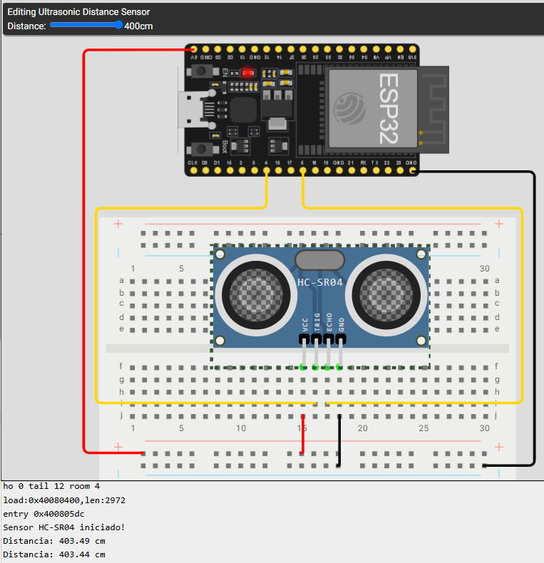

# HC-SR04 - Ultrassom
O sensor de ultrassom HC-SR04 é um dispositivo que permite medir distâncias utilizando ondas sonoras de alta frequência. Ele é amplamente utilizado em projetos de robótica, automação e sistemas de medição devido à sua precisão e facilidade de uso.

## Exemlo de circuito que utiliza o sensor HC-SR04
O circuito básico para utilizar o sensor HC-SR04 envolve a conexão de quatro pinos:
- VCC: Alimentação do sensor (geralmente 5V)
- GND: Terra
- Trig: Pino de disparo, utilizado para enviar o sinal de ultrassom
- Echo: Pino de recepção, utilizado para receber o sinal refletido
<br>
```c
#define TRIG_PIN 4
#define ECHO_PIN 5

void setup() {
  Serial.begin(9600);

  pinMode(TRIG_PIN, OUTPUT);
  pinMode(ECHO_PIN, INPUT);

  Serial.println("Sensor HC-SR04 iniciado!");
}

void loop() {

  // Gera pulso ultrassonico
  digitalWrite(TRIG_PIN, LOW);
  delayMicroseconds(2);

  digitalWrite(TRIG_PIN, HIGH);
  delayMicroseconds(10);

  digitalWrite(TRIG_PIN, LOW);

  // Mede o tempo de retorno do sinal
  long duracao = pulseIn(ECHO_PIN, HIGH, 30000);

  // Calcula a distancia em centimetros
  if (duracao == 0) {
    Serial.println("Nenhum objeto detectado!");
  } else {
    float distancia = duracao * 0.0343 / 2;

    Serial.print("Distancia: ");
    Serial.print(distancia);
    Serial.println(" cm");
  }

  // Aguarda 5 segundos
  delay(5000);
}
```
O código acima configura o sensor HC-SR04 para medir a distância de um objeto. Ele envia um pulso ultrassônico e mede o tempo que leva para o sinal refletido retornar ao sensor. A distância é então calculada com base no tempo de voo do sinal.
- O resultado da medição é exibido no monitor serial a cada 5 segundos. Se nenhum objeto for detectado, uma mensagem informando isso será exibida.