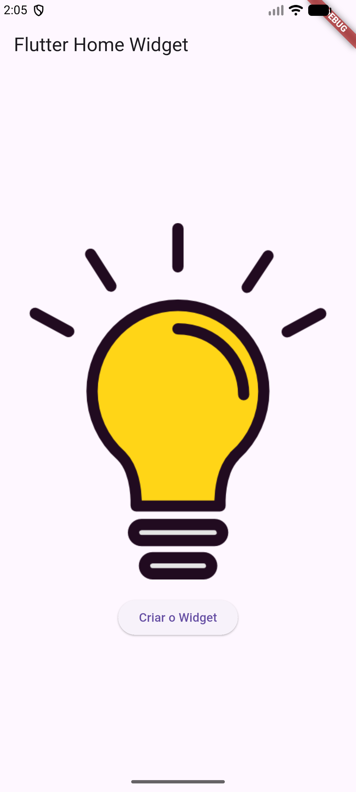
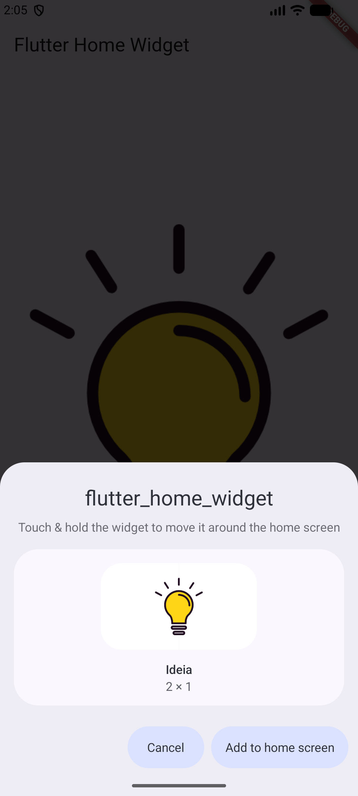
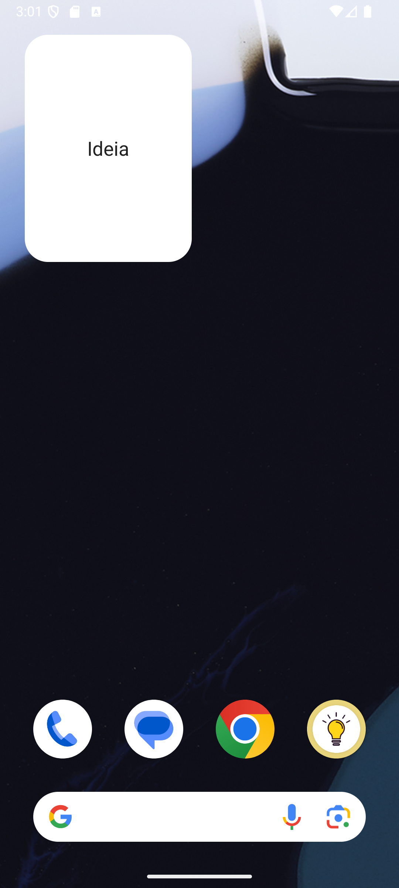

# Aula07 - Home Screen Widget e Widget personalizado
Para criar um widget personalizado que exibe uma informação na tela do seu aplicativo Flutter, você deve definir uma classe que estende StatelessWidget (se o conteúdo for estático) ou StatefulWidget (se a informação mudar ao longo do tempo)

## Widget [personalizado](./widget_personalizado.md)

<details>
<summary><h2> Home Screen Widget </h2></summary>

Essa "telinha que parece um ícone" na verdade se chama **Home Screen Widget** (ou App Widget no Android e WidgetKit no iOS).
Como esses widgets rodam diretamente no sistema operacional do celular (fora do app), o Flutter não consegue desenhá-los na tela de forma 100% direta. A forma mais fácil e recomendada de fazer isso é usando o pacote chamado home_widget. Ele serve como uma ponte para enviar dados ou até mesmo uma imagem gerada no Flutter direto para a tela inicial.
- Aqui está o resumo prático de como estruturar isso para exibir uma imagem:

### 1 Crie um novo App
Crie um novo App flutter chamado `flutter_home_widget` com a seguinte estrutura de pastas:
```
flutter_home_widget/
  assets/
    icone.png
  lib/
    main.dart
  pubspec.yaml
```
- Baixe o arquivo `./icone.png` deste repositório e coloque na pasta `assets/` do projeto.
### 2 Instale as dependências
Instale as dependências necessárias no arquivo pubspec.yaml:
- configurando o pacote `home_widget`,
- configurando o pacote `flutter_launcher_icons` para gerar o ícone do aplicativo
- apontando o caminho da imagem do ícone do aplicativo para `assets/icone.png`
- e apontando a pasta `assets/` para a imagem que será exibida no widget e adicionando as permissões necessárias para o Android e iOS.
  - execute os comandos a seguir no terminal para adicionar as dependências:
```bash
flutter pub add home_widget
flutter pub add flutter_launcher_icons --dev
```
  - configure o arquivo `pubspec.yaml` com o seguinte conteúdo:
```yaml
dependencies:
  flutter:
    sdk: flutter
  home_widget: ^0.10.0

dev_dependencies:
  flutter_test:
    sdk: flutter
  flutter_lints: ^6.0.0
  flutter_launcher_icons: ^0.14.4

flutter_launcher_icons:
  android: true
  ios: true
  image_path: "assets/icone.png"
  remove_alpha_ios: true

flutter:
  uses-material-design: true
  assets:
    - assets/
```
  - execute o comando a seguir no terminal para baixar as dependências:
```bash
flutter pub get
```
- Configure a imagem como icone do aplicativo
  - Dê o comando a seguir para configurar o ícone do aplicativo com a imagem que você baixou:
```bash
flutter pub run flutter_launcher_icons:main
```

### 3 Configure o Android
- Abra o arquivo `android/app/src/main/AndroidManifest.xml` e adicione as permissões necessárias para o widget funcionar corretamente:
```xml
<manifest xmlns:android="http://schemas.android.com/apk/res/android">
    <uses-permission android:name="android.permission.INTERNET"/>
    <application
        android:label="flutter_home_widget"
        android:name="${applicationName}"
        android:icon="@mipmap/ic_launcher">
        <activity
            android:name=".MainActivity"
            android:exported="true"
            android:launchMode="singleTop"
            android:taskAffinity=""
            android:theme="@style/LaunchTheme"
            android:configChanges="orientation|keyboardHidden|keyboard|screenSize|smallestScreenSize|locale|layoutDirection|fontScale|screenLayout|density|uiMode"
            android:hardwareAccelerated="true"
            android:windowSoftInputMode="adjustResize">
            <!-- Specifies an Android theme to apply to this Activity as soon as
                 the Android process has started. This theme is visible to the user
                 while the Flutter UI initializes. After that, this theme continues
                 to determine the Window background behind the Flutter UI. -->
            <meta-data
              android:name="io.flutter.embedding.android.NormalTheme"
              android:resource="@style/NormalTheme"
              />
            <intent-filter>
                <action android:name="android.intent.action.MAIN"/>
                <category android:name="android.intent.category.LAUNCHER"/>
            </intent-filter>
        </activity>
        <receiver
            android:name=".MeuHomeWidget"
            android:exported="true"
            android:label="Ideia">
            <intent-filter>
                <action android:name="android.appwidget.action.APPWIDGET_UPDATE" />
            </intent-filter>
            <meta-data
                android:name="android.appwidget.provider"
                android:resource="@xml/meu_home_widget_info" />
        </receiver>
        <!-- Don't delete the meta-data below.
             This is used by the Flutter tool to generate GeneratedPluginRegistrant.java -->
        <meta-data
            android:name="flutterEmbedding"
            android:value="2" />
    </application>
    <!-- Required to query activities that can process text, see:
         https://developer.android.com/training/package-visibility and
         https://developer.android.com/reference/android/content/Intent#ACTION_PROCESS_TEXT.

         In particular, this is used by the Flutter engine in io.flutter.plugin.text.ProcessTextPlugin. -->
    <queries>
        <intent>
            <action android:name="android.intent.action.PROCESS_TEXT"/>
            <data android:mimeType="text/plain"/>
        </intent>
    </queries>
</manifest>
```
### 4 Configure o `main.dart`
```dart
import 'package:flutter/material.dart';
import 'package:flutter/services.dart';
import 'package:home_widget/home_widget.dart';

void main() {
  runApp(const MainApp());
}

class MainApp extends StatelessWidget {
  const MainApp({super.key});

  // Função para atualizar o widget com uma imagem de fundo e um texto 'Ideia'
  Future<void> atualizarWidgetExterno(BuildContext context) async {
    const String androidWidgetName =
        'com.example.flutter_home_widget.MeuHomeWidget';

    // Caminho da imagem que você quer mostrar no widget
    String imagemCaminho =
        'https://github.com/wellifabio/senai2026/blob/main/ds/turmas/2DES_A/4%C2%BA%20Semestre/03-ppdm2/aula07/icone.png?raw=true';

    try {
      await HomeWidget.saveWidgetData<String>('chave_imagem', imagemCaminho);
      await HomeWidget.saveWidgetData<String>('chave_texto', 'Ideia');

      await HomeWidget.updateWidget(qualifiedAndroidName: androidWidgetName);
      await HomeWidget.requestPinWidget(
        qualifiedAndroidName: androidWidgetName,
      );
    } on PlatformException catch (exception) {
      if (!context.mounted) return;
      ScaffoldMessenger.of(context).showSnackBar(
        SnackBar(
          content: Text(
            'Não foi possível criar o widget: ${exception.message ?? exception.code}',
          ),
        ),
      );
    }
  }

  @override
  Widget build(BuildContext context) {
    return MaterialApp(
      home: Scaffold(
        appBar: AppBar(title: const Text('Flutter Home Widget')),
        body: Center(
          child: Column(
            mainAxisAlignment: MainAxisAlignment.center,
            spacing: 20,
            children: [
              Image(image: AssetImage('assets/icone.png')),
              ElevatedButton(
                onPressed: () => atualizarWidgetExterno(context),
                child: const Text('Criar o Widget'),
              ),
            ],
          ),
        ),
      ),
    );
  }
}

```
- Execute em um emulador ou dispositivo físico para testar o aplicativo.
  - clique no botão "Criar o Widget" para criar o widget na tela inicial do celular.
- Ou em um dispositivo físico, pressione e segure na tela inicial, selecione "Widgets" e procure pelo widget do seu aplicativo para adicioná-lo à tela inicial.
- Ou gere o apk e instale no seu dispositivo físico para testar o aplicativo.
```bash
flutter build apk --release
```
- Crie ou edite o arquivo `./flutter_home_widget.iml`
```iml
<?xml version="1.0" encoding="UTF-8"?>
<module type="JAVA_MODULE" version="4">
  <component name="NewModuleRootManager" inherit-compiler-output="true">
    <exclude-output />
    <content url="file://$MODULE_DIR$">
      <sourceFolder url="file://$MODULE_DIR$/lib" isTestSource="false" />
      <sourceFolder url="file://$MODULE_DIR$/test" isTestSource="true" />
      <excludeFolder url="file://$MODULE_DIR$/.dart_tool" />
      <excludeFolder url="file://$MODULE_DIR$/.idea" />
      <excludeFolder url="file://$MODULE_DIR$/build" />
    </content>
    <orderEntry type="sourceFolder" forTests="false" />
    <orderEntry type="library" name="Dart SDK" level="project" />
    <orderEntry type="library" name="Flutter Plugins" level="project" />
    <orderEntry type="library" name="Dart Packages" level="project" />
  </component>
</module>
```
## Resultado

||||
|-|-|-|
|Home|CLick do Botão|Widget|


</details>

## Exemplo: [App Receitas](https://github.com/wellifabio/sesi_ppdm2_receitas_flutter_api_2026.git)
App de receitas que consome uma API REST para exibir informações sobre pratos e receitas.
- O app utiliza widgets personalizados que mostra o nome e foto de uma receita aleatória e ao ser clicado abre a tela home com a lista de receitas.

## Atividade prática
- Crie um **Home Screen Widget** em um de seus projetos Flutter, que exiba informações relevantes para o seu aplicativo.
### Entrega
- Teste o widget no seu aplicativo e tire um print da tela mostrando o widget em ação.
- Acrescente o print da tela no README.md do seu repositório GitHub.
- Apresente o repositório para o professor vistar e avaliar a atividade.
