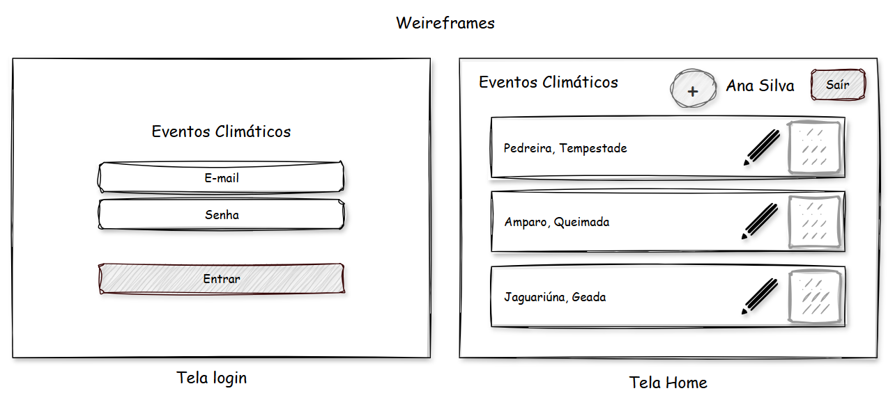

# Aula05 - Recursos Avançados - Prisma Seed
## Prisma Seed
Criar e preencher um banco de dados relacional com dados de teste.

## Projeto: Eventos Climáticos
Sistema para registro de eventos climáticos extremos.

## Documentação


## Vamos desenvolver
#### Passo 01 - Iniciar o projeto
- Criar uma pasta `c:/App/eventos` e abrir com o VsCode
- Abrir o Terminal `CTRL + '` e digitar os comandos para criar o back-end com a extenção do prof Reenye.
```bash
npx backend-aula api
cd api
npm uninstall prisma @prisma/client
npm install prisma@7 @prisma/client@7
```
#### Passo 02 - Alterar o nome do banco de dados no arquivo **.env**
```js
PORT=3000
DATABASE_URL="mysql://root@localhost:3306/mydb"
```
de 
```js
PORT=3000
DATABASE_URL="mysql://root@localhost:3306/eventos"
```
#### Passo 03 - Editar o prisma/schema.prisma
Adicionando os models (tabelas e relacionamentos) conforme o DER e Diagrama de classes
```js
generator client {
  provider = "prisma-client-js"
}

datasource db {
  provider = "mysql"
}

model Usuario{
  id Int @id @default(autoincrement())
  nome String @db.VarChar(100)
  email String @db.VarChar(100) @unique
  senha String @db.VarChar(100)
  eventos Evento[]
}

model Evento{
  id Int @id @default(autoincrement())
  usuarioId Int
  cidade String @db.VarChar(50)
  tipoEvento String @db.VarChar(50)
  temperaturaMaxima Float?
  data DateTime @default(now())
  nivelImpacto String @db.VarChar(100)
  usuario Usuario  @relation(fields: [usuarioId], references: [id])
}
```
#### Passo 04 - Implantar o Modelo no SGBD
- Se usar o XAMPP, abrir o Control Panel e dar **start** em MySQL, se usa o MariaDB diretamente, apenas instalar as dependências do **prisma**
- Ainda no terminal na pasta `/api` rode os comandos abaixo:
```bash
npx prisma generate
npx prisma migrate dev --name init
```
- Crie o `.gitignore` dentro da pasta `/api` contendo:
```txt
node_modules
.env
package-lock.json
prisma/migrations
```

#### Passo 05 - Semear os dados de teste
- Crie o arquivo `prisma/seed.js` contendo:
```js
const prisma = require('../src/data/prisma')

async function main() {
    await prisma.$transaction(async (transaction) => {
        await transaction.evento.deleteMany()
        await transaction.usuario.deleteMany()

        const usuarios = await Promise.all([
            transaction.usuario.create({ data: { nome: "Ana Silva", email: "ana@email.com", senha: "senha123" } }),
            transaction.usuario.create({ data: { nome: "Maria Silva", email: "maria@email.com", senha: "senha123" } }),
            transaction.usuario.create({ data: { nome: "João Oliveira", email: "joao@email.com", senha: "senha123" } }),
            transaction.usuario.create({ data: { nome: "Paula Martins", email: "paula@email.com", senha: "senha123" } }),
            transaction.usuario.create({ data: { nome: "Pedro Souza", email: "pedro@email.com", senha: "senha123" } })
        ])
        console.log("Usuarios de teste cadastrados.")
        const eventos = await Promise.all([
            transaction.evento.create({ data: { usuarioId: 1, cidade: "Amparo", tipoEvento: "Tempestade", temperaturaMaxima: 34.2, nivelImpacto: "Derrubada de árvores e destelhamento de edifícios" } }),
            transaction.evento.create({ data: { usuarioId: 1, cidade: "Campinas", tipoEvento: "Queimada", temperaturaMaxima: 38.2, nivelImpacto: "Perda de mata atlântica e área agrícola" } }),
            transaction.evento.create({ data: { usuarioId: 2, cidade: "Jaguariúna", tipoEvento: "Tempestade Magnética", temperaturaMaxima: 30.1, nivelImpacto: "Acidentes com pessoas atingidas por raios" } }),
            transaction.evento.create({ data: { usuarioId: 2, cidade: "Pedreira", tipoEvento: "Tempestade", temperaturaMaxima: 34.2, nivelImpacto: "Derrubada de árvores e destelhamento de edifícios" } }),
            transaction.evento.create({ data: { usuarioId: 3, cidade: "Monte Alegre do Sul", tipoEvento: "Vendaval", temperaturaMaxima: 36.2, nivelImpacto: "Derrubada de árvores e destelhamento de edifícios" } }),
            transaction.evento.create({ data: { usuarioId: 3, cidade: "Santo Antônio de Posse", tipoEvento: "Baixa umidade relativa do ar", temperaturaMaxima: 39.7, nivelImpacto: "Excesso de atendimento a pessoas com problemas respiratórios" } }),
            transaction.evento.create({ data: { usuarioId: 4, cidade: "Serra Negra", tipoEvento: "Geada", temperaturaMaxima: 6.2, nivelImpacto: "Perda de produção agrícola" } }),
            transaction.evento.create({ data: { usuarioId: 5, cidade: "Águas de Lindóia", tipoEvento: "Tempestade", temperaturaMaxima: 34.8, nivelImpacto: "Derrubada de árvores e destelhamento de edifícios" } })
        ])
        console.log("Eventos de teste cadastrados.")
    })
}

main()
    .catch(e => {
        console.error(e)
        process.exit(1)
    })
    .finally(async () => {
        await prisma.$disconnect()
    })
```
- Acrescente a referencia ao arquivo **seed: 'node prisma/seed.js'** no arquivo **prisma.config.ts**
```js
import "dotenv/config";
import { defineConfig } from "prisma/config";

export default defineConfig({
  schema: "prisma/schema.prisma",
  migrations: {
    path: "prisma/migrations",
    seed: 'node prisma/seed.js',
  },
  datasource: {
    url: process.env["DATABASE_URL"],
  },
});
```
- Execute a semeadura com o comando
```bash
npx prisma db seed
```
- Conclua os controllers e rotas com os comanados a seguir e execute o projeto para testar:
```bash
npx backend-aula -models
# ou
npx backend-aula -r usuario
npx backend-aula -r evento
# e
npx backend-aula -insomnia
npm run dev
```

## Reimplantar o banco de dados
Sempre que precisar remover e instalar novamente o banco de dados pelo **prisma**
- 1 Exclua a pasta `prisma/migrations` e dê os seguintes comandos:
```bash
npx prisma migrate reset
npx prisma migrate dev --name init
npx prisma db seed
```

## Situação de Aprendizagem
### Contextualização
Após executar o back-end e realizar testes unitários e de integração com os dados no banco de dados, precisamos de uma UI (interface para o usuário)
<br>
### Desafio
Crie uma pasta chamada `web` dentro da pasta eventos no seu projeto full stack
- Desenvolva um front-end atendendo os seguintes requisitos funcionais:
    - [RF001] Tela de login (Validando os acessos com os usuários cadastrados)
        - [RF001.1] Desenvolva um controller e rota para login no back-end tipo POST que devolva os dados do usuário
    - [RF002] Tela Home
        - [RF002.1] Mostre o nome do usuário logado no header da Home
        - [RF002.2] Botão "Sair" no header da Home
        - [RF002.3] CRUD de eventos climáticos

### Entregas
Envie para um repositório no github com README.md no padrão de sempre
- Apresente ao professor para visto
    