<table align="center" border="0" cellpadding="0" cellspacing="0">
  <tr>
    <td>
      
    </td>
    <td style="padding-left: 50px; vertical-align: middle;">
      <span style="font-size: 50px; font-weight: bold;">Créditos</span>
      <span style="font-size: 55px; margin-left: 20px;">
        <a href="https://github.com" style="text-decoration: none;">@nickfelisbelo</a>
      </span>
    </td>
  </tr>
</table>


## Parte 1: Subir o banco de dados no Supabase

1. Entre no [Supabase](https://supabase.com/)
2. Clique em **New project*<br>
    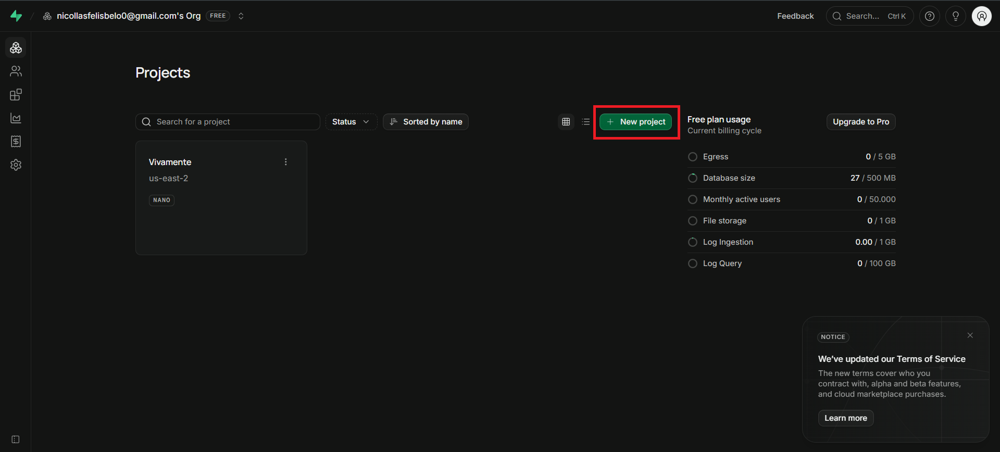<br>
3. Preencha os campos<br>
    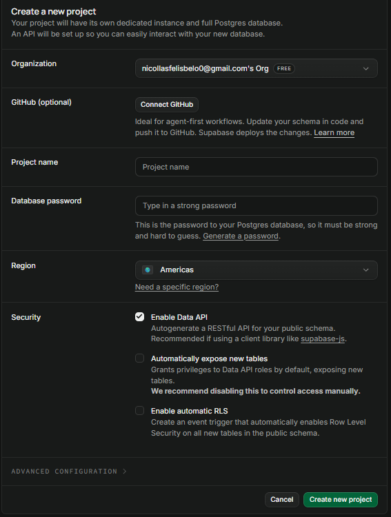<br>
    - Organization: nome da organização que você deseja
    - Project Name: nome do seu projeto
    - Database password: uma senha forte, **só com letras e números**
    - Region: região mais próxima
4. Clique em **Create new project**<br>
    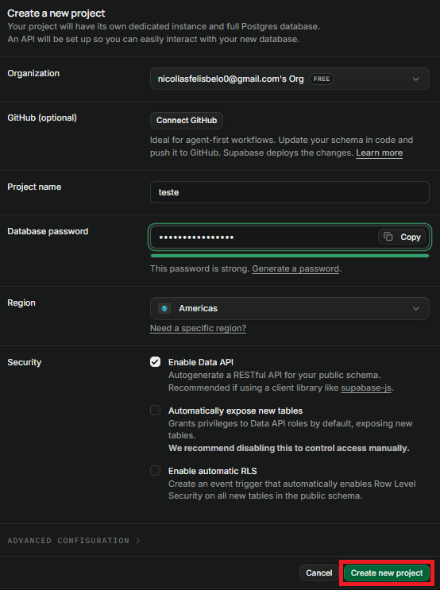<br>
5. Clique em **Connect**<br>
    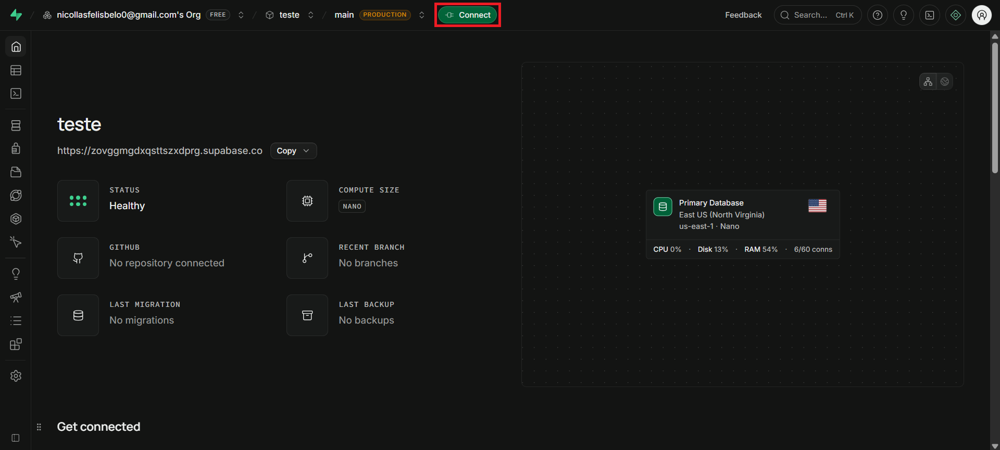<br>
6. Selecione a aba **ORM**<br>
    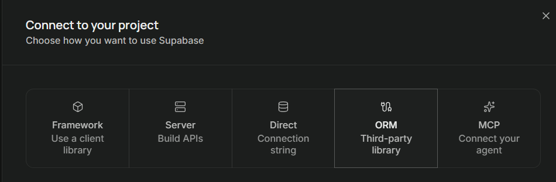<br>
7. Selecione **Prisma** como ORM<br>
    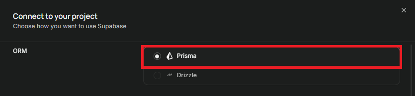<br>
8. Copie o conteúdo do **.env.local**<br>
    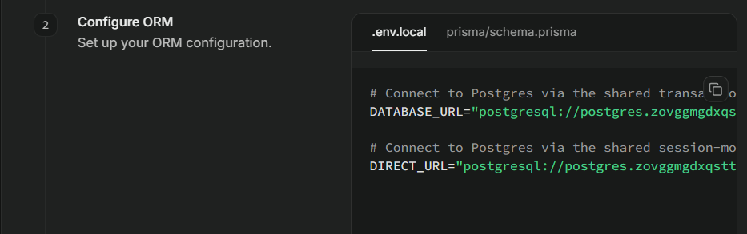<br>
9. Cole no seu arquivo **.env**<br>
    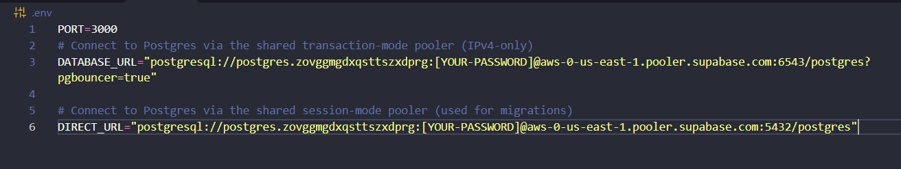<br>

10. Vá para o projeto
    - Instale as dependências:
    ```bash
    npm i
    npm install @prisma/adapter-pg pg dotenv
    ```
    - Substitua o `prisma.config.ts`:
    ```ts
    import "dotenv/config";
    import { defineConfig } from "prisma/config";

    export default defineConfig({
      schema: "prisma/schema.prisma",
      datasource: {
        url: process.env.DIRECT_URL ?? process.env.DATABASE_URL ?? "",
      },
    });
    ```

    - No `prisma/schema.prisma`, deixe o datasource só com o provider como postgresql:
    ```prisma
    datasource db {
      provider = "postgresql"
    }
    ```

    Se o projeto veio de MySQL, apague as pastas antigas dentro de `prisma/migrations`.

    - Mude o `src/data/prisma.js`
    ```js
    const { PrismaClient } = require("@prisma/client");
    const { PrismaPg } = require("@prisma/adapter-pg");

    const url = new URL(process.env.DATABASE_URL);
    url.searchParams.delete("sslmode");
    url.searchParams.delete("pgbouncer");

    const adapter = new PrismaPg({
      connectionString: url.toString(),
      ssl: { rejectUnauthorized: false },
      max: 3,
    });

    module.exports = new PrismaClient({ adapter });
    ```

    - Crie uma pasta no back chamada api e nela um arquivo chamado ``index.js``
    
    ```js
    const app = require("../server");

    module.exports = app;
    ```

    - Crie as tabelas no Supabase:
    ```bash
    npx prisma migrate dev --name init
    prisma generate
    npx prisma migrate deploy
    ```

## Parte 2: Subir o back na Vercel
Antes de tudo crie na raiz da pasta um arquivo chamado ``vercel.json``:
```json
{
  "version": 2,
  "rewrites": [
    {
      "source": "/(.*)",
      "destination": "/api/index"
    }
  ]
}
```
Agora, siga os passos:
1. Entre na [Vercel](https://vercel.com/)<br>
2. Selecione **Create new**<br>
   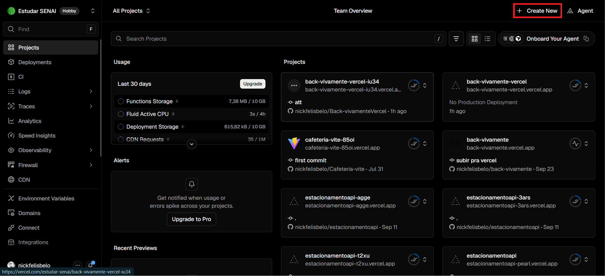<br>
3. Selecione **Project**<br>
   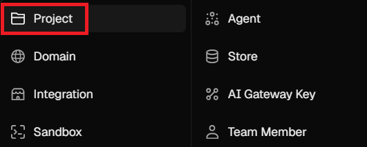<br>
4. Selecione o repositório com o Backend que deseja hospedar online<br>
   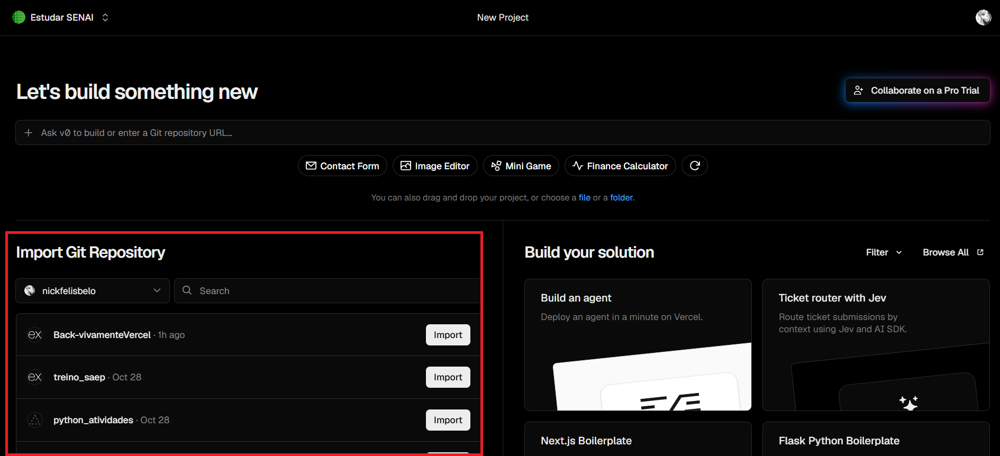<br>
5. Selecione o **Other** em Application Preset <br>
   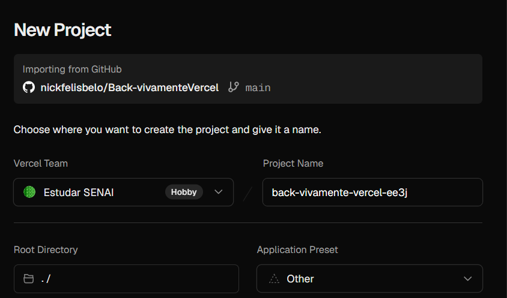<br>
6. Em **Build and Output Settings** habilite *Install Command* e escreva o comando:
   ```cmd
   npm install
   ```
   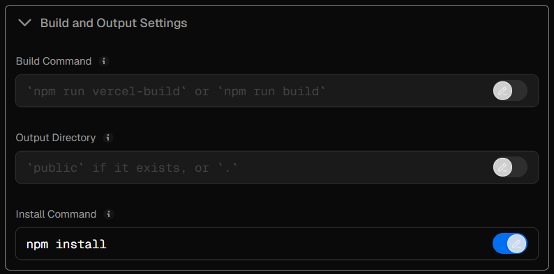
7. Importe o ``.env`` em Environment Variables <br>
   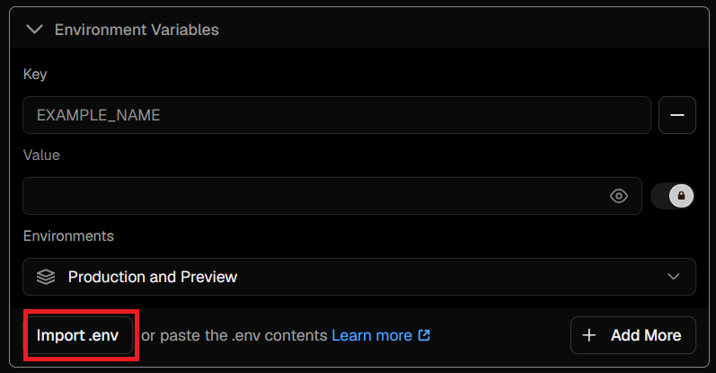
8. Selecione **Create Project**
9. Selecione Deploy<br>
    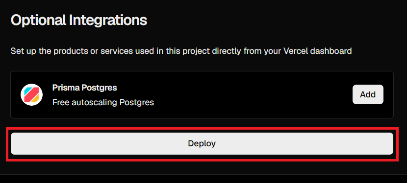
10. Veja se deu certo 
    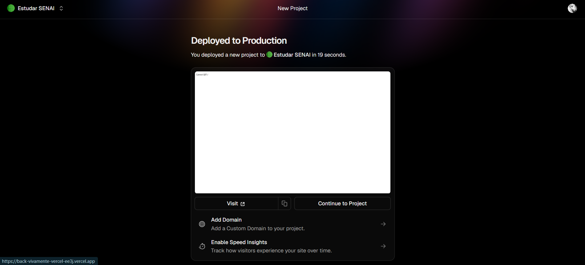
