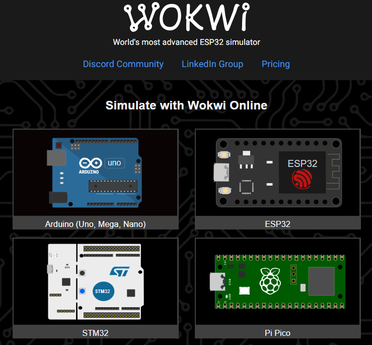
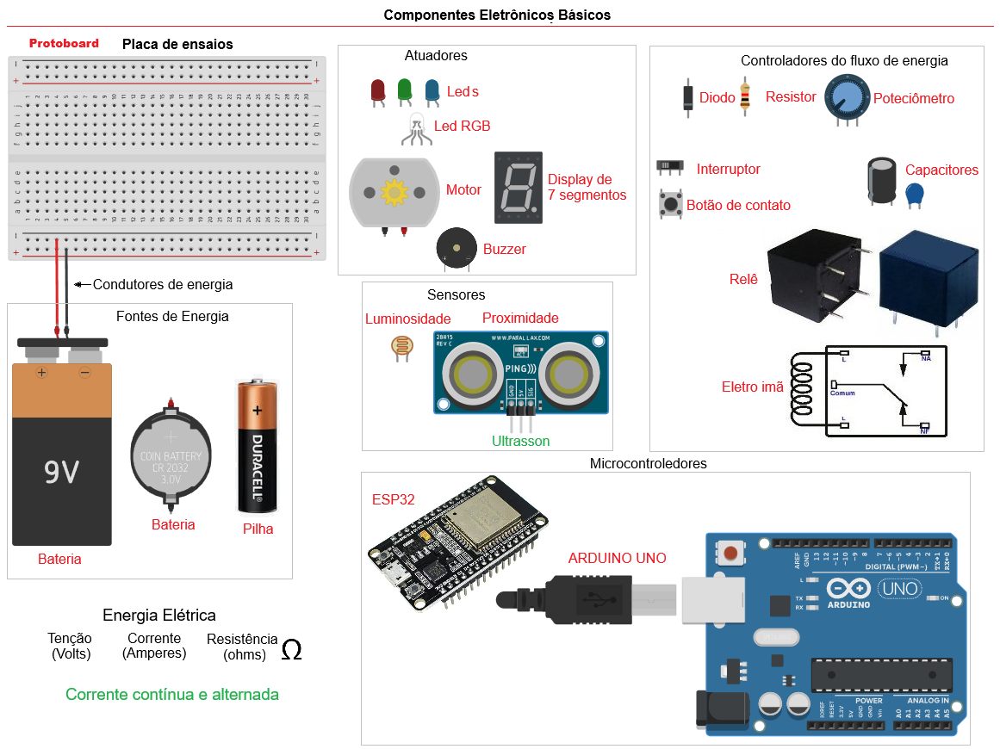
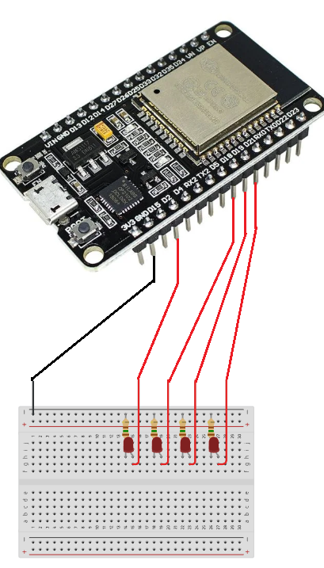
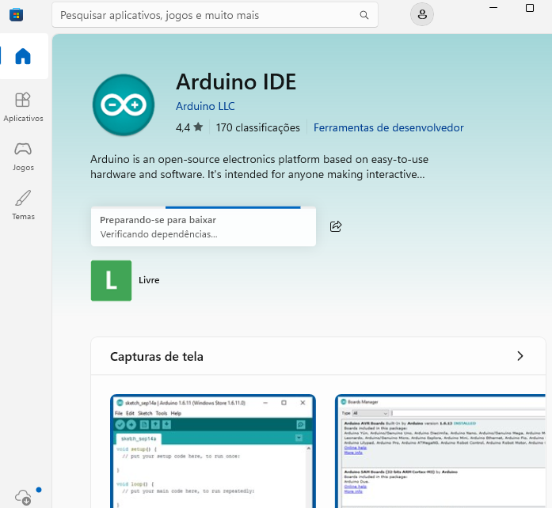

# Aula06 - KIT ESP32

## Objetivos
Realizar experimentos com componentes reais (ESP32) a partir de experimentos feitos com simulador **[TinkerCAD](https://www.tinkercad.com/)**

## Simulador com ESP32 [WOKWI](https://wokwi.com/)


### Capacidades Técnicas
- 1 Identificar as diferenças entre as aplicações do **[IoT e IIoT](./iot_vs_iiot.md)** 
- 2 Identificar os tipos de hardwares e soluções disponíveis 
- 3 Configurar ambientes de desenvolvimento

### Capacidades Socioemocionais
- 1 Demonstrar autogestão
- 6 Trabalhar em equipe

## Conhecimentos
- 1 Automação em IoT 
  - 1.1 Residencial  
  - 1.2 Pessoal 
  - 1.3 Industriais  
  - 1.4 Aplicações 
- 2 Requisitos para Instalação 
  - 2.1 Hardware 
    - 2.1.1 Conectividade 
    - 2.1.2 Periféricos 
  - 2.2 Sensores e Atuadores 
    - 2.2.1 Interfaces de I/O 
    - 2.2.2 Analógica 
- 3 Ambiente de desenvolvimento 
  - 3.1 IDE (Integrated Development Enviroment) 
    - 3.1.1. Tipos 
    - 3.1.2. Seleção 
  - 3.2. Configuração 

## Laboratórios
**Prático**: Utilizando kit IoT com microcontrolador **ESP32**
### Componentes Eletrônicos Básicos


### 1 Acendendo vários Leds
ESP32 é uma placa com microcontroladora digital programável em linguagem C, possui vários pinos que podem ser programáveis onde conectamos sensores e atuadores, a principal vantagem sobre o ARDUINO é o WIFI integrado.
<br>
<br>O circuito acima possui 4 leds, 4 resistores ligados as portas D2, D18, D19 e D21, e conectados em uma **protoboard** e ligados no **GND** (terra).<br>O código a seguir pisca as luzes alternadamente de duas em duas.
```c
int led1 = 2;
int led2 = 18;
int led3 = 19;
int led4 = 21;

void setup(){
	pinMode(led1, OUTPUT);
	pinMode(led2, OUTPUT);
	pinMode(led3, OUTPUT);
	pinMode(led4, OUTPUT);
}
void loop(){
	digitalWrite(led1,1);
  	digitalWrite(led2,0);
  	digitalWrite(led3,1);
  	digitalWrite(led4,0);
  	delay(500);
  	digitalWrite(led1,0);
  	digitalWrite(led2,1);
  	digitalWrite(led3,0);
  	digitalWrite(led4,1);
  	delay(500);
}
```
## Instalando a IDE
- Baixar a [Arduino PLC IDE 1.1.0](https://www.arduino.cc/en/software/)
    - Download for Windows
        - Istalar no computador
<br>
- Após instalar a IDE, baixe o drive
- [Baixar o Driver ESP32](https://www.pololu.com/file/0J14/pololu-cp2102-windows-220616.zip)
- Descompacte e através da IDE instale-o

## Testando
- Após a IDE e drive instalado
    - Conectar o cabo USB no ESP32 e computador
    - Transmitir o código

## Desafio 01
Em grupo de até 5 integrantes:
- Desenvolva o experimento de **semáforo** simulado no ThinkerCAD na [Aula3](../aula03/README.md)
    - Monte o protótipo na protoboard
    - Implante o código utilizando a IDE do Arduino
- OBS: Alguns componentes de kits diversos não estão funcionais, compartilhem os componentes dos 8 kits tomando cuidados para não queimá-los
## Entregas
- Fotografe e/ou faça um pequeno vídeo do experimento funcionando
    - Suba o vídeo no Youtube ou se forem fotos em um repositório no github com as fotos em README.md
- Apresente o vídeo ou o repositório com as fotos para o instrutor **vistar**.