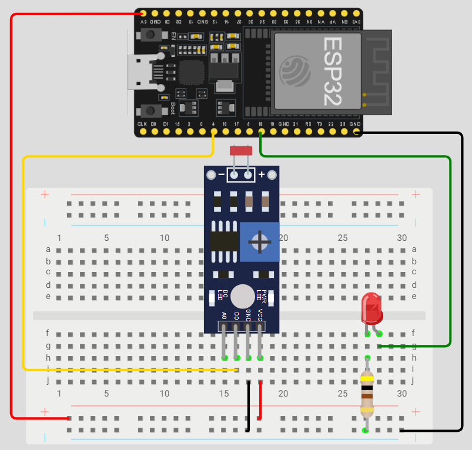
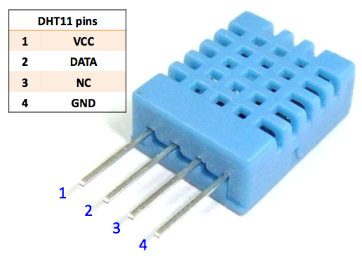
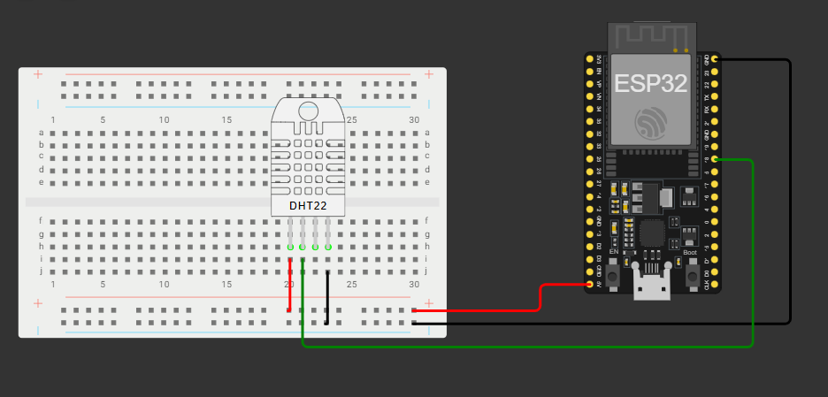
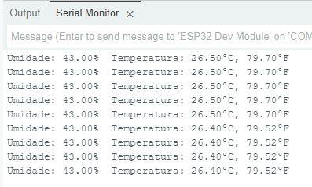

# Aula08 - Mais Sensores e Atuadores
A seguir segue mais alguns experimentos com sensores e atuadores, além de desafios para fixação do conteúdo.

<details><summary><h2>Competências Específicas e Socioemocionais</h2></summary>

### Capacidades Técnicas
- 3 Configurar ambientes de desenvolvimento
- 4 Implementar protocolos de comunicação
- 5 Integrar a automação em plataforma na nuvem 
- 6 Conectar as aplicações gráficas  

### Capacidades Socioemocionais
- 1 Demonstrar autogestão
- 2 Demonstrar pensamento analítico
- 3 Demonstrar inteligência emocional
- 6 Trabalhar em equipe 

## Conhecimentos
- 2 Requisitos para Instalação 
  - 2.1 Hardware 
    - 2.1.1 Conectividade 
    - 2.1.2 Periféricos 
  - 2.2 Sensores e Atuadores 
    - 2.2.1 Interfaces de I/O 
    - 2.2.2 Analógica 
- 3 Ambiente de desenvolvimento 
  - 3.1 IDE (Integrated Development Enviroment) 
    - 3.1.1. Tipos 
    - 3.1.2. Seleção 
  - 3.2. Configuração 
- 6 Interfaces com elementos visuais 
  - interativos 
  - 6.1 Linguagens 
    - 6.1.1 HTML 
    - 6.1.2 CSS  
    - 6.1.3 JavaScript 
  - 6.2 Aplicações  
    - 6.2.1 Visualização de Dados 
    - 6.2.2 Interatividade 
    - 6.2.3 Testes  
    - 6.2.4 Feedbacks

</details>

<details><summary><h2>Experimento01 - Automação de Luzes com fotoresistor</h2></summary>
Automação de luzes é o uso de dispositivos eletrônicos e sistemas inteligentes para controlar a iluminação de forma automática ou remota, sem depender exclusivamente da ação manual (interruptores comuns).

### Sensor LDR
- LDR significa Light Dependent Resistor (resistor dependente de luz).
- Também chamado de fotoresistor.
- Ele é feito de material semicondutor que altera sua resistência conforme a intensidade da luz que incide sobre ele.

### Como funciona?

- No claro: a resistência do LDR diminui bastante (pode chegar a algumas centenas de ohms).
- No escuro: a resistência do LDR aumenta muito (pode ir para centenas de kΩ até MΩ).

### Vantagens na automação LDR
- Conforto → acender e apagar luzes automaticamente ou pelo celular.
- Eficiência energética → evita deixar luzes acesas sem necessidade.
- Segurança → simulação de presença em casas (liga e desliga mesmo se não houver ninguém).
- Acessibilidade → ajuda idosos e pessoas com mobilidade reduzida.
OBS: Muito utilizado no IoT de cidades inteligentes.

## Estrutura do projeto com ESP32


## Código de automação
```c
const int ldrPin = 4; // Pino ADC onde o LDR está conectado
const int ledPin = 18; // Pino do LED para acionar

void setup() {
  Serial.begin(9600); // Inicia a comunicação serial
  pinMode(ledPin, OUTPUT); // Configura o pino do LED como saída
  pinMode(ldrPin, INPUT);
}

void loop() {
  int ldrValue = analogRead(ldrPin); // Lê o valor do sensor LDR
  ldrValue = map(ldrValue, 0, 5000, 30, 0);
  
  Serial.print("Valor do LDR: ");
  Serial.println(ldrValue);

  if (ldrValue < 26) { // Se estiver mais escuro 
    digitalWrite(ledPin, HIGH); // Liga o LED
  } else { // Se estiver mais claro
    digitalWrite(ledPin, LOW); // Desliga o LED
  }

  delay(500); // Aguarda 500 milissegundos antes da próxima leitura
}
```
</details>

<details><summary><h2>Experimento02 - Sensor de humidade e temperatura - DHT11</h2></summary>

O DHT11 é um sensor digital de baixo custo e alta confiabilidade usado para medir a **umidade relativa e a temperatura do ambiente**. Ele possui um termistor **NTC** para a leitura da temperatura e um sensor tipo **HR202** para a umidade. O sensor se comunica com um microcontrolador (como o ESP32) através de um sinal serial digital, sendo ideal para projetos de automação, monitoramento climático e sistemas de controle ambiental. 

### Principais características:

#### Medição digital:
- Envia dados de umidade e temperatura em formato digital, o que simplifica a integração com microcontroladores. 

#### Confiabilidade:
- Oferece excelente estabilidade e confiabilidade a longo prazo para as medições. 

#### Baixo custo:
- É uma solução acessível para projetos que necessitam de monitoramento de temperatura e umidade. 

#### Faixa de medição:
- A temperatura é medida entre 0 e 50 °C, e a umidade relativa entre 20% e 90%. 

#### Facilidade de uso:
- Integra-se facilmente com plataformas como o ESP32, exigindo apenas poucos fios para a conexão. 

#### Aplicações:
- É amplamente utilizado em monitoramento de estufas, automação residencial, controle de sistemas de ar condicionado (HVAC) e projetos de Internet das Coisas (IoT). 

## Estrutura do projeto utilizando ESP32



### Código de Automação
Execute este código no ESP32 para ler os valores de umidade e temperatura do sensor DHT11 e exibi-los no monitor serial.
- Copie e cole no Arduino IDE e clique em **Upload** para enviar o código para o ESP32.

```c
#include "DHT.h"

#define DHTPIN 18
#define DHTTYPE DHT11

DHT dht(DHTPIN, DHTTYPE); // constructor to declare our sensor

void setup() {

  Serial.begin(115200);
  Serial.println("O ESP32 Esta funcionando");
    
  dht.begin();
}

void loop() {
  
  delay(1000);
  
  float h = dht.readHumidity();
  //Faz a leitura da umidade em %.
  float t = dht.readTemperature();
  //Faz a leitura da temperatura em Celsius
  float f = dht.readTemperature(true);
  //Faz a leiturada temperatura em Fahrenheit

  if (isnan(h) || isnan(t) || isnan(f)) {
    Serial.println("Sem receber dados do sensor DHT11");
    return;
    //Trata erros de leitura do sensor
  }

  Serial.print("Umidade: ");
  Serial.print(h);
  Serial.print("%  Temperatura: ");
  Serial.print(t);
  Serial.print("°C, ");
  Serial.print(f);
  Serial.println("°F");
  
}
```

### Retorno esperado


</details>

## [Questionário IoT](https://forms.gle/xss6zCjHxAFJRxzU8)

## Atividades
Em grupo, execute com o Kit IoT os experimentos propostos e registre os resultados obtidos. Em seguida, responda ao questionário acima.

## Situação de Aprendizagem
Projeto completo com sensores, API e Site com gráficos.

### Contextualização
O Sr. Fujimo Nakombi, descendente de japoneses, é um cultivador de cogumelos e precisa monitorar as condições ambientais de sua estufa para garantir o crescimento saudável dos cogumelos. Ele deseja um sistema que permita visualizar os dados em tempo real e receber alertas quando os parâmetros estiverem fora do intervalo ideal.

## Desafio
O projeto consiste em criar um sistema de monitoramento ambiental utilizando o microcontrolador ESP32, sensores de temperatura e umidade (DHT11), e um sensor de luminosidade (LDR). O objetivo é coletar dados ambientais, enviá-los para uma API na nuvem e exibir os resultados em um site com gráficos interativos.

- Desenvolvar uma API semelhante a da aula anterior, porém os dados devem ser armazanados em um banco de dados relacional (MySQL ou PostgreSQL).
### MER DER

|Medicao|
|---|
|id, int (Autoincrement) PK|
|data, Datetime, default(NOW())|
|temperatura, float|
|umidade, float|
|luminosidade, float|

### Protótipo IoT
O Protótipo IoT deve ser capaz de:
- Ler os valores de temperatura, umidade e luminosidade.
- Enviar para a API a cada 1 minuto através de requisições HTTP POST.
    - Modelo de corpo da requisição:
    ```json
    {
      "temperatura": 25.5,
      "umidade": 60.2,
      "luminosidade": 300
    }
    ```

### Site com gráficos
O site deve ser capaz de:
- Exibir os dados em gráficos interativos (temperatura, umidade e luminosidade) utilizando bibliotecas como Chart.js ou D3.js.

## Entregas
- **Fotografe** e/ou faça um breve **vídeo** do experimento funcionando
    - Suba o vídeo no Youtube ou as fotos em um repositório no github com o README.md mostrando uma descrição da experiência e fotos do protótipo.
    - Passos para executar a API, print do site com gráficos e print do banco de dados com os dados recebidos.
