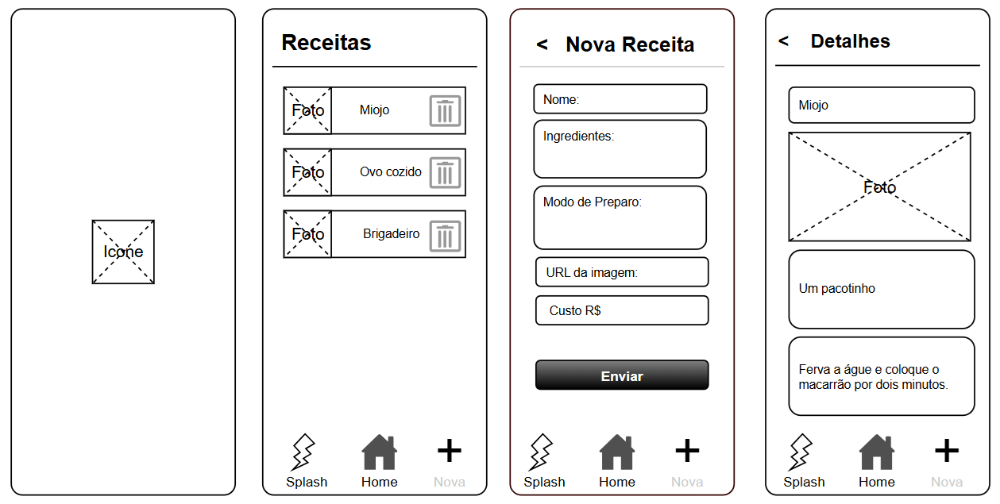

# Aula06 - App com dados de uma API própria

Consumir dados de uma API Back-end própria com um app Flutter

---
## [Exemplo App TehcMAN](https://github.com/wellifabio/flutter_techman_2025.git)
---

## Passos
- 1 Implante sua API na [Vercel(Aula03 de projetos)](../../05-psof3/aula03/README.md) ou outro serviço de nuvem.
- 2 Acrescente no seu App as dependência `http` para consumir dados da sua API e `shared_preferences` caso precise compartilhar dados entre as telas:

```bash
flutter pub add http
flutter pub add intl
flutter pub add shared_preferences
flutter pub get
```
- Confira o arquivo `pubspec.yaml`:

```yaml
dependencies:
  flutter:
    sdk: flutter
  http: ^1.1.0
  intl: ^0.20.3
  shared_preferences: ^2.2.2
```
- 3 Acrescente a linha a seguir no arquivo `./android/app/src/main/AndroidManifest.xml` antes da tag `<application>` para que as permissões de internet sejam habilitadas a API responda.

```xml
<uses-permission android:name="android.permission.INTERNET"/>
```

- 4 Desenvolva e teste seu **App**, ao concluir gere o `.APK` para instalar e testar em um aparelho Android.

## Livro de Receitas
Projeto Mobile (Flutter) com Full Stack
- API de um livro de Receitas implantada na **Vercel** [https://receitasapi-b-2025.vercel.app/](https://receitasapi-b-2025.vercel.app/)
- Repositório da API no [Github](https://github.com/wellifabio/receitasapp-expo-2025.git)
- [Front End do livro de Receitas](https://wellifabio.github.io/receitas-web-2025/) consumindo a API
- Repositório do Front-End no [Github](https://github.com/wellifabio/receitasapi-b-2025)

### Desafio!
Crie um aplicativo de um livro de receitas que consuma esta API, modele semelhante ao wireframe abaixo, aplique tema, splash screen com animação e um design profissional.
<br>

### Entrega
- Envie para o Github com o arquivo [APK](../aula02/README.md) na pasta assets.
- Apresente o **App** ao instrutor em um aparelho celular Android, utilize um dos dispositivos disponibilizados pelo SESI.

---

<details>
<summary><h2>Tutorial App Receitas</h2></summary>

#### Configuração a estrutura do App
- 1 Criar um **novo projeto** Flutter
- 2 Instalar as dependências
```bash
flutter pub add http
flutter pub add flutter_launcher_icons --dev
flutter pub get
```
- 3 Acrescente a linha a seguir no arquivo `./android/app/src/main/AndroidManifest.xml` antes da tag `<application>` 
```xml
<uses-permission android:name="android.permission.INTERNET"/>
```
- 4 Crie a seguinte estrutura de pastas em lib
```
lib
  ui
    style
      colors.dart
      theme.dart
    home.dart
    formulario.dart
    splash.dart
  api.dart
  main.dart
```
- 5 Crie uma pasta `assets` em seu aplicativo
  - baixe o [icone.png](./icone.png) do aplicativo dentro dela
  - dentro de assets crie uma pasta fonts `assets/fonts` e baixe a font [PatrickHand-Regular.ttf](./PatrickHand-Regular.ttf) para dentro dela
```
assets
  fonts
    PatrickHand-Regular.ttf
  icone.png
```
  - acrescente os caminhos e confira o `pubspec.yaml` conforme modelo a seguir:
```yaml
dependencies:
  flutter:
    sdk: flutter
  http: ^1.6.0

dev_dependencies:
  flutter_test:
    sdk: flutter
  flutter_lints: ^6.0.0
  flutter_launcher_icons: ^0.14.4

flutter_launcher_icons:
  android: true
  ios: true
  image_path: "assets/icone.png"
  remove_alpha_ios: true

flutter:
  uses-material-design: true
  assets:
    - assets/
  fonts:
    - family: PatrickHand
      fonts:
        - asset: assets/fonts/PatrickHand-Regular.ttf
```
- 6 Execute os seguinte comando no terminal do VsCode para configurar o logo:
```bash
flutter pub get
flutter pub run flutter_launcher_icons:main
```
#### Desenvolvimento as telas
- main.dart
```dart
import 'package:flutter/material.dart';

import 'ui/splash.dart';
import 'ui/style/theme.dart';

void main() {
  runApp(
    MaterialApp(
      title: "Anotações",
      theme: AppTheme.temaClaro,
      darkTheme: AppTheme.temaEscuro,
      themeMode: ThemeMode.system,
      home: Splash(),
    ),
  );
}
```
- api.dart
```dart
class Api {
  static String baseUrl = 'https://receitasapi-b-2025.vercel.app/';
  static String getEndPoint(String endpoint) {
    return '$baseUrl$endpoint';
  }
}
```
- ui/style/colors.dart
```dart
import 'package:flutter/material.dart';

abstract class AppColors {
  static const Color c1 = Color(0xFF664422);
  static const Color c2 = Color(0xFF886644);
  static const Color c3 = Color(0xFFBB9988);
  static const Color c4 = Color(0xFFDDAA99);
  static const Color c5 = Color(0xFFFFFAEE);
}
```
- ui/style/theme.dart
```dart
import 'package:flutter/material.dart';

import 'colors.dart';

abstract class AppTheme {
  static ThemeData temaClaro = ThemeData.light().copyWith(
    scaffoldBackgroundColor: AppColors.c5,
    primaryColor: AppColors.c1,
    drawerTheme: DrawerThemeData(
      backgroundColor: AppColors.c5,
      scrimColor: AppColors.c2,
    ),
    iconTheme: IconThemeData(color: AppColors.c1),
    floatingActionButtonTheme: FloatingActionButtonThemeData(
      backgroundColor: AppColors.c1,
      foregroundColor: AppColors.c5,
      shape: CircleBorder(),
    ),
    appBarTheme: AppBarTheme(
      backgroundColor: AppColors.c1,
      foregroundColor: AppColors.c4,
      titleTextStyle: TextStyle(
        color: AppColors.c5,
        fontSize: 20,
        fontWeight: FontWeight.bold,
        fontFamily: 'PatrickHand',
      ),
    ),
    textButtonTheme: TextButtonThemeData(
      style: ButtonStyle(foregroundColor: WidgetStatePropertyAll(AppColors.c1)),
    ),
    inputDecorationTheme: InputDecorationThemeData(
      labelStyle: TextStyle(color: AppColors.c1),
      border: OutlineInputBorder(
        borderSide: BorderSide(width: 1.0, color: AppColors.c1),
        borderRadius: BorderRadius.circular(10.0),
      ),
      focusedBorder: OutlineInputBorder(
        borderSide: BorderSide(width: 1.5, color: AppColors.c2),
        borderRadius: BorderRadius.circular(10.0),
      ),
    ),
    elevatedButtonTheme: ElevatedButtonThemeData(
      style: ElevatedButton.styleFrom(
        backgroundColor: AppColors.c1,
        foregroundColor: AppColors.c5,
        textStyle: TextStyle(
          fontSize: 16,
          fontWeight: FontWeight.bold,
          fontFamily: 'PatrickHand',
        ),
      ),
    ),
    dialogTheme: DialogThemeData(
      backgroundColor: AppColors.c5,
      titleTextStyle: TextStyle(
        color: AppColors.c1,
        fontSize: 20,
        fontWeight: FontWeight.bold,
        fontFamily: 'PatrickHand',
      ),
      contentTextStyle: TextStyle(
        color: AppColors.c1,
        fontSize: 16,
        fontFamily: 'PatrickHand',
      ),
    ),
    listTileTheme: ListTileThemeData(
      textColor: AppColors.c1,
      iconColor: AppColors.c2,
      style: ListTileStyle.list,
      titleTextStyle: TextStyle(
        color: AppColors.c1,
        fontSize: 16,
        fontWeight: FontWeight.bold,
        fontFamily: 'PatrickHand',
      ),
    ),
    dividerTheme: DividerThemeData(color: AppColors.c1),
    bottomNavigationBarTheme: BottomNavigationBarThemeData(
      backgroundColor: AppColors.c5,
      selectedIconTheme: IconThemeData(color: AppColors.c1),
      selectedItemColor: AppColors.c1,
      selectedLabelStyle: TextStyle(
        fontWeight: FontWeight.bold,
        fontSize: 18,
        fontFamily: 'PatrickHand',
      ),
    ),
  );
  static ThemeData temaEscuro = ThemeData.dark().copyWith(
    scaffoldBackgroundColor: AppColors.c1,
    primaryColor: AppColors.c5,
    drawerTheme: DrawerThemeData(
      backgroundColor: AppColors.c1,
      scrimColor: AppColors.c5,
    ),
    iconTheme: IconThemeData(color: AppColors.c5),
    floatingActionButtonTheme: FloatingActionButtonThemeData(
      backgroundColor: AppColors.c5,
      foregroundColor: AppColors.c1,
      shape: CircleBorder(),
    ),
    appBarTheme: AppBarTheme(
      backgroundColor: AppColors.c5,
      foregroundColor: AppColors.c2,
      titleTextStyle: TextStyle(
        color: AppColors.c1,
        fontSize: 20,
        fontWeight: FontWeight.bold,
        fontFamily: 'PatrickHand',
      ),
    ),
    textButtonTheme: TextButtonThemeData(
      style: ButtonStyle(foregroundColor: WidgetStatePropertyAll(AppColors.c5)),
    ),
    inputDecorationTheme: InputDecorationThemeData(
      labelStyle: TextStyle(color: AppColors.c4),
      border: OutlineInputBorder(
        borderSide: BorderSide(width: 1.0, color: AppColors.c4),
        borderRadius: BorderRadius.circular(10.0),
      ),
      focusedBorder: OutlineInputBorder(
        borderSide: BorderSide(width: 1.5, color: AppColors.c5),
        borderRadius: BorderRadius.circular(10.0),
      ),
    ),
    elevatedButtonTheme: ElevatedButtonThemeData(
      style: ElevatedButton.styleFrom(
        backgroundColor: AppColors.c3,
        foregroundColor: AppColors.c1,
        textStyle: TextStyle(
          fontSize: 16,
          fontWeight: FontWeight.bold,
          fontFamily: 'PatrickHand',
        ),
      ),
    ),
    dialogTheme: DialogThemeData(
      backgroundColor: AppColors.c1,
      titleTextStyle: TextStyle(
        color: AppColors.c5,
        fontSize: 20,
        fontWeight: FontWeight.bold,
        fontFamily: 'PatrickHand',
      ),
      contentTextStyle: TextStyle(
        color: AppColors.c4,
        fontSize: 16,
        fontFamily: 'PatrickHand',
      ),
    ),
    listTileTheme: ListTileThemeData(
      textColor: AppColors.c5,
      iconColor: AppColors.c4,
      style: ListTileStyle.list,
      titleTextStyle: TextStyle(
        color: AppColors.c5,
        fontSize: 16,
        fontWeight: FontWeight.bold,
        fontFamily: 'PatrickHand',
      ),
    ),
    dividerTheme: DividerThemeData(color: AppColors.c3),
    bottomNavigationBarTheme: BottomNavigationBarThemeData(
      backgroundColor: AppColors.c1,
      selectedIconTheme: IconThemeData(color: AppColors.c5),
      selectedItemColor: AppColors.c5,
      selectedLabelStyle: TextStyle(
        fontWeight: FontWeight.bold,
        fontSize: 18,
        fontFamily: 'PatrickHand',
      ),
    ),
  );
}
```
- ui/formulario.dart
```dart
import 'dart:convert';

import 'package:flutter/material.dart';
import 'package:http/http.dart' as http;

import '../api.dart';
import 'home.dart';
import 'splash.dart';

class Formulario extends StatefulWidget {
  const Formulario({super.key, this.id});

  final int? id;

  @override
  State<Formulario> createState() => _FormularioState();
}

class _FormularioState extends State<Formulario> {
  final TextEditingController _nomeController = TextEditingController();
  final TextEditingController _ingredientesController = TextEditingController();
  final TextEditingController _modoFazerController = TextEditingController();
  final TextEditingController _imgController = TextEditingController();
  final TextEditingController _custoController = TextEditingController();
  String tipo = 'SALGADA';
  static const List<String> _tipos = ['DOCE', 'SALGADA', 'BEBIDA'];
  int _tabIndice = 2;

  @override
  void initState() {
    super.initState();
    if (widget.id != null) carregarReceita();
  }

  @override
  void dispose() {
    _nomeController.dispose();
    _ingredientesController.dispose();
    _modoFazerController.dispose();
    _imgController.dispose();
    _custoController.dispose();
    super.dispose();
  }

  @override
  Widget build(BuildContext context) {
    return Scaffold(
      appBar: AppBar(
        title: widget.id == null
            ? Text('Nova receita')
            : Text('Editar da receita'),
      ),
      body: Center(
        child: Padding(
          padding: EdgeInsets.all(18.0),
          child: Column(
            mainAxisAlignment: MainAxisAlignment.center,
            spacing: 20,
            children: [
              TextField(
                controller: _nomeController,
                decoration: InputDecoration(
                  hintText: 'Nome da receita',
                  labelText: 'Nome da receita:',
                ),
              ),
              DropdownButton<String>(
                value: tipo,
                hint: Text('Selecione o tipo'),
                isExpanded: true,
                items: _tipos.map((String item) {
                  return DropdownMenuItem<String>(
                    value: item,
                    child: Text(item),
                  );
                }).toList(),
                onChanged: (String? novoValor) {
                  if (novoValor == null) return;
                  setState(() {
                    tipo = novoValor;
                  });
                },
              ),
              TextField(
                controller: _ingredientesController,
                decoration: InputDecoration(
                  hintText: 'Ingredientes',
                  labelText: 'Ingredientes:',
                ),
              ),
              TextField(
                controller: _modoFazerController,
                decoration: InputDecoration(
                  hintText: 'Modo de fazer',
                  labelText: 'Modo de fazer:',
                ),
              ),
              TextField(
                controller: _imgController,
                decoration: InputDecoration(
                  hintText: 'URL da imagem',
                  labelText: 'URL da imagem:',
                ),
                onChanged: (_) => setState(() {}),
              ),
              Image.network(
                _imgController.text,
                width: 200,
                height: 180,
                fit: BoxFit.cover,
                errorBuilder: (context, error, stackTrace) =>
                    const Icon(Icons.image_not_supported, size: 200),
              ),
              TextField(
                controller: _custoController,
                keyboardType: TextInputType.numberWithOptions(decimal: true),
                decoration: InputDecoration(
                  hintText: 'Custo R\$ aproximado',
                  labelText: 'Custo R\$ aproximado:',
                ),
              ),
              widget.id == null
                  ? ElevatedButton(
                      onPressed: enviarReceita,
                      child: Text('Registrar Receita'),
                    )
                  : ElevatedButton(
                      onPressed: alterarReceita,
                      child: Text('Alterar Receita'),
                    ),
            ],
          ),
        ),
      ),
      bottomNavigationBar: BottomNavigationBar(
        currentIndex: _tabIndice,
        onTap: (indice) {
          setState(() {
            _tabIndice = indice;
          });
          if (indice == 0) {
            Navigator.pushReplacement(
              context,
              MaterialPageRoute(builder: (context) => Splash()),
            );
          }
          if (indice == 1) {
            Navigator.pushReplacement(
              context,
              MaterialPageRoute(builder: (context) => Home()),
            );
          }
          if (indice == 2) {
            Navigator.pushReplacement(
              context,
              MaterialPageRoute(builder: (context) => Formulario()),
            );
          }
        },
        type: BottomNavigationBarType.fixed,
        items: const [
          BottomNavigationBarItem(icon: Icon(Icons.flash_on), label: 'Splash'),
          BottomNavigationBarItem(icon: Icon(Icons.home), label: 'Home'),
          BottomNavigationBarItem(icon: Icon(Icons.add), label: 'Nova'),
        ],
      ),
    );
  }

  Future<void> carregarReceita() async {
    try {
      final url = Uri.parse(Api.getEndPoint('receitas/${widget.id}'));
      final response = await http.get(url);
      if (response.statusCode == 200) {
        final data = json.decode(response.body);
        if (data is Map) {
          final receita = Map<String, dynamic>.from(data);
          final custo = receita['custoAproximado'];
          final custoCarregado = custo is num
              ? custo.toDouble()
              : double.tryParse(custo?.toString() ?? '') ?? 0.0;
          if (!mounted) return;
          setState(() {
            _nomeController.text = receita['nome']?.toString() ?? '';
            final tipoCarregado = receita['tipo']?.toString();
            tipo = _tipos.contains(tipoCarregado)
                ? tipoCarregado!
                : _tipos.first;
            _ingredientesController.text =
                receita['ingredientes']?.toString() ?? '';
            _modoFazerController.text = receita['modoFazer']?.toString() ?? '';
            _imgController.text = receita['img']?.toString() ?? '';
            _custoController.text = custoCarregado == 0
                ? ''
                : custoCarregado.toString();
          });
          return;
        }
      }
      _mostrarMensagem('Não foi possível carregar esta receita.');
    } catch (_) {
      _mostrarMensagem('Erro ao se comunicar com a API!');
    }
  }

  Future<void> enviarReceita() async {
    final nome = _nomeController.text.trim();
    final ingredientes = _ingredientesController.text.trim();
    final modoFazer = _modoFazerController.text.trim();
    final img = _imgController.text.trim();
    final custo = double.tryParse(
      _custoController.text.trim().replaceAll(',', '.'),
    );

    if (nome.isEmpty ||
        ingredientes.isEmpty ||
        modoFazer.isEmpty ||
        custo == null ||
        custo == 0) {
      _mostrarMensagem('Preencha todos os campos obrigatórios');
      return;
    }

    final dados = <String, dynamic>{
      'nome': nome,
      'tipo': tipo,
      'ingredientes': ingredientes,
      'modoFazer': modoFazer,
      if (img.isNotEmpty) 'img': img,
      'custoAproximado': custo,
    };

    try {
      final url = Uri.parse(Api.getEndPoint('receitas'));
      final response = await http.post(
        url,
        headers: {'Content-Type': 'application/json'},
        body: json.encode(dados),
      );
      if (response.statusCode == 201 && mounted) {
        Navigator.pushReplacement(
          context,
          MaterialPageRoute(builder: (context) => Splash()),
        );
      } else {
        _mostrarMensagem('Erro ao registar receita na API');
      }
    } catch (_) {
      _mostrarMensagem('Erro ao se comunicar com a API');
    }
  }

  Future<void> alterarReceita() async {
    final nome = _nomeController.text.trim();
    final ingredientes = _ingredientesController.text.trim();
    final modoFazer = _modoFazerController.text.trim();
    final img = _imgController.text.trim();
    final custo = double.tryParse(
      _custoController.text.trim().replaceAll(',', '.'),
    );

    if (nome.isEmpty ||
        ingredientes.isEmpty ||
        modoFazer.isEmpty ||
        custo == null ||
        custo == 0) {
      _mostrarMensagem('Preencha todos os campos obrigatórios');
      return;
    }

    final dados = <String, dynamic>{
      'nome': nome,
      'tipo': tipo,
      'ingredientes': ingredientes,
      'modoFazer': modoFazer,
      if (img.isNotEmpty) 'img': img,
      'custoAproximado': custo,
    };

    try {
      final url = Uri.parse(Api.getEndPoint('receitas/${widget.id}'));
      final response = await http.put(
        url,
        headers: {'Content-Type': 'application/json'},
        body: json.encode(dados),
      );
      if (response.statusCode == 202 && mounted) {
        Navigator.pushReplacement(
          context,
          MaterialPageRoute(builder: (context) => Splash()),
        );
      } else {
        _mostrarMensagem('Erro ao alterar receita na API');
      }
    } catch (_) {
      _mostrarMensagem('Erro ao se comunicar com a API');
    }
  }

  void _mostrarMensagem(String mensagem) {
    if (!mounted) return;
    ScaffoldMessenger.of(context).showSnackBar(
      SnackBar(content: Text(mensagem), duration: const Duration(seconds: 2)),
    );
  }
}
```
- ui/home.dart
```dart
import 'dart:convert';

import 'package:flutter/material.dart';
import 'package:http/http.dart' as http;

import '../api.dart';
import 'formulario.dart';
import 'splash.dart';

class Home extends StatefulWidget {
  const Home({super.key});

  @override
  State<Home> createState() => _HomeState();
}

class _HomeState extends State<Home> {
  List<dynamic> receitas = [], filtradas = [];
  bool _carregando = true;
  int _tabIndice = 1;
  String _filtroNome = '';
  String? _filtroTipo;

  @override
  void initState() {
    super.initState();
    carregarReceitas();
  }

  @override
  Widget build(BuildContext context) {
    return Scaffold(
      appBar: AppBar(title: Text('Receitas')),
      body: _carregando
          ? Center(child: CircularProgressIndicator())
          : receitas.isEmpty
          ? Center(child: Text('Nenhuma receita encontrada'))
          : Padding(
              padding: EdgeInsets.all(18.0),
              child: Column(
                mainAxisAlignment: MainAxisAlignment.start,
                spacing: 12,
                children: [
                  TextField(
                    decoration: InputDecoration(hintText: 'Filtro'),
                    onChanged: filtroNome,
                  ),
                  SingleChildScrollView(
                    scrollDirection: Axis.horizontal,
                    child: Row(
                      mainAxisAlignment: MainAxisAlignment.start,
                      spacing: 12,
                      children: [
                        ElevatedButton(
                          onPressed: () => filtroTipo(null),
                          child: Text("TODAS"),
                        ),
                        ElevatedButton(
                          onPressed: () => filtroTipo("DOCE"),
                          child: Text("DOCE"),
                        ),
                        ElevatedButton(
                          onPressed: () => filtroTipo("SALGADA"),
                          child: Text("SALGADA"),
                        ),
                        ElevatedButton(
                          onPressed: () => filtroTipo("BEBIDA"),
                          child: Text("BEBIDA"),
                        ),
                      ],
                    ),
                  ),
                  Expanded(
                    child: ListView.separated(
                      padding: EdgeInsets.all(12),
                      itemCount: filtradas.length,
                      separatorBuilder: (context, index) => Divider(height: 1),
                      itemBuilder: (context, index) {
                        final item = filtradas[index] as Map<String, dynamic>;
                        final nome = item['nome']?.toString() ?? 'Receita';
                        final img = item['img']?.toString() ?? '';
                        final int id = item['id'] ?? 0;
                        return ListTile(
                          contentPadding: EdgeInsets.symmetric(vertical: 8),
                          onTap: () => detalhes(id),
                          leading: SizedBox(
                            width: 56,
                            height: 56,
                            child: img.isNotEmpty
                                ? Image.network(
                                    img,
                                    width: 56,
                                    height: 56,
                                    fit: BoxFit.cover,
                                    errorBuilder: (
                                      context,
                                      error,
                                      stackTrace,
                                    ) => Icon(Icons.image_not_supported),
                                  )
                                : Icon(Icons.restaurant, size: 32),
                          ),
                          title: Text(nome),
                          trailing: GestureDetector(
                            onTap: () => confirmaExcluir(item['id']),
                            child: Icon(Icons.delete),
                          ),
                        );
                      },
                    ),
                  ),
                ],
              ),
            ),
      bottomNavigationBar: BottomNavigationBar(
        currentIndex: _tabIndice,
        onTap: (indice) {
          setState(() {
            _tabIndice = indice;
          });
          if (indice == 0) {
            Navigator.pushReplacement(
              context,
              MaterialPageRoute(builder: (context) => Splash()),
            );
          }
          if (indice == 2) {
            Navigator.pushReplacement(
              context,
              MaterialPageRoute(builder: (context) => Formulario()),
            );
          }
        },
        type: BottomNavigationBarType.fixed,
        items: const [
          BottomNavigationBarItem(icon: Icon(Icons.flash_on), label: 'Splash'),
          BottomNavigationBarItem(icon: Icon(Icons.home), label: 'Home'),
          BottomNavigationBarItem(icon: Icon(Icons.add), label: 'Nova'),
        ],
      ),
    );
  }

  Future<void> carregarReceitas() async {
    setState(() {
      _carregando = true;
    });
    try {
      final url = Uri.parse(Api.getEndPoint('receitas'));
      final response = await http.get(url);
      if (response.statusCode == 200) {
        final data = json.decode(response.body);
        if (data is List) {
          setState(() {
            receitas = data;
            filtradas = data;
          });
          return;
        }
      }
      setState(() {
        receitas = [];
      });
    } catch (_) {
      setState(() {
        receitas = [];
      });
      if (mounted) {
        ScaffoldMessenger.of(context).showSnackBar(
          SnackBar(
            content: Text(
              'Erro ao se comunicar com a API! Necessário acesso a internet.',
            ),
            duration: Duration(seconds: 2),
          ),
        );
      }
    } finally {
      setState(() {
        _carregando = false;
      });
    }
  }

  void detalhes(int id) {
    final receita = receitas.firstWhere(
      (item) => item is Map && item['id'] == id,
      orElse: () => null,
    );
    if (mounted) {
      showDialog(
        context: context,
        builder: (BuildContext context) => AlertDialog(
          title: Text(receita["nome"]),
          content: ConstrainedBox(
            constraints: BoxConstraints(maxHeight: 400),
            child: SingleChildScrollView(
              physics: BouncingScrollPhysics(),
              child: Column(
                children: [
                  SizedBox(
                    width: 150,
                    height: 150,
                    child: receita["img"].isNotEmpty
                        ? Image.network(
                            receita["img"],
                            width: 150,
                            height: 150,
                            fit: BoxFit.cover,
                            errorBuilder: (context, error, stackTrace) =>
                                Icon(Icons.image_not_supported),
                          )
                        : Icon(Icons.restaurant, size: 32),
                  ),
                  Text('Ingredientes: ${receita["ingredientes"]}'),
                  Text('Modo de fazer: ${receita["modoFazer"]}'),
                  Text('Custo aproximado: R\$ ${receita["custoAproximado"]}'),
                ],
              ),
            ),
          ),
          actions: [
            TextButton(
              child: const Text('Cancelar'),
              onPressed: () {
                Navigator.of(context).pop();
              },
            ),
            ElevatedButton(
              child: Text('Editar'),
              onPressed: () => Navigator.pushReplacement(
                context,
                MaterialPageRoute(builder: (context) => Formulario(id: id)),
              ),
            ),
          ],
        ),
      );
    }
  }

  void confirmaExcluir(int id) {
    if (mounted) {
      showDialog(
        context: context,
        builder: (BuildContext context) => AlertDialog(
          title: Text("Confirma exclusão"),
          content: Text('Deseja realmente excluir a receita número: $id'),
          actions: [
            TextButton(
              child: const Text('Cancelar'),
              onPressed: () {
                Navigator.of(context).pop();
              },
            ),
            ElevatedButton(
              child: const Text('Confirmar'),
              onPressed: () {
                Navigator.of(context).pop();
                excluirReceita(id);
              },
            ),
          ],
        ),
      );
    }
  }

  Future<void> excluirReceita(int id) async {
    try {
      final url = Uri.parse(Api.getEndPoint('receitas/$id'));
      final response = await http.delete(url);
      if (response.statusCode == 204) {
        carregarReceitas();
      } else {
        if (mounted) {
          ScaffoldMessenger.of(context).showSnackBar(
            SnackBar(
              content: Text('Erro ao excluir receita!'),
              duration: Duration(seconds: 2),
            ),
          );
        }
      }
    } catch (_) {
      if (mounted) {
        ScaffoldMessenger.of(context).showSnackBar(
          SnackBar(
            content: Text('Erro ao se comunicar com a API!'),
            duration: Duration(seconds: 2),
          ),
        );
      }
    }
  }

  void filtroNome(String? nome) {
    _filtroNome = nome?.trim() ?? '';
    _aplicarFiltros();
  }

  void filtroTipo(String? tipo) {
    _filtroTipo = tipo;
    _aplicarFiltros();
  }

  void _aplicarFiltros() {
    final nomeBusca = _filtroNome.toLowerCase();
    setState(() {
      filtradas = receitas.where((receita) {
        if (receita is! Map) return false;
        final nome = receita['nome']?.toString().toLowerCase() ?? '';
        final tipo = receita['tipo']?.toString().toUpperCase();
        return nome.contains(nomeBusca) &&
            (_filtroTipo == null || tipo == _filtroTipo);
      }).toList();
    });
  }
}
```
- ui/splash.dart
```dart
import 'package:flutter/material.dart';

import 'home.dart';

class Splash extends StatefulWidget {
  const Splash({super.key});

  @override
  State<Splash> createState() => _SplashState();
}

class _SplashState extends State<Splash> with TickerProviderStateMixin {
  late AnimationController aumentar;
  double tamanho = 0;

  @override
  void initState() {
    super.initState();
    animacao();
  }

  void animacao() {
    aumentar = AnimationController(vsync: this, duration: Duration(seconds: 2))
      ..addListener(() {
        setState(() {
          tamanho = aumentar.value;
        });
      });
    aumentar.forward().then((value) => irParaHome());
  }

  void irParaHome() async {
    await Navigator.pushReplacement(
      context,
      MaterialPageRoute(builder: (context) => Home()),
    );
  }

  @override
  Widget build(BuildContext context) {
    return Scaffold(
      body: Center(
        child: Transform.scale(
          scale: tamanho,
          child: Image.asset("assets/icone.png", width: 300),
        ),
      ),
    );
  }
}
```
- Salve e execute no navegador ou emulador
```bash
flutter pub get
flutter run
```
</details>