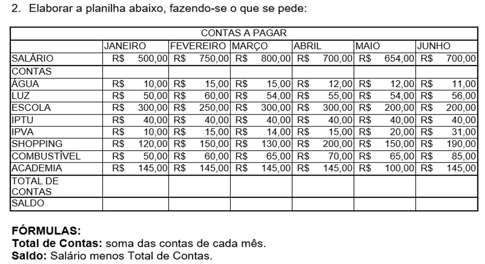

# Aula03 - Desafios

## Desafio Nº 01
### Contextualização
Sempre é bom ter uma noção de como fazer um orçamento doméstico simples, a planilha a seguir é um exemplo de um orçamento do ano de 2006 quando o sálário mínimo era aproximadamente R$ 350,00
### Desafio
Abra uma nova planilha do Excel e digite a seguinte planilha
 
