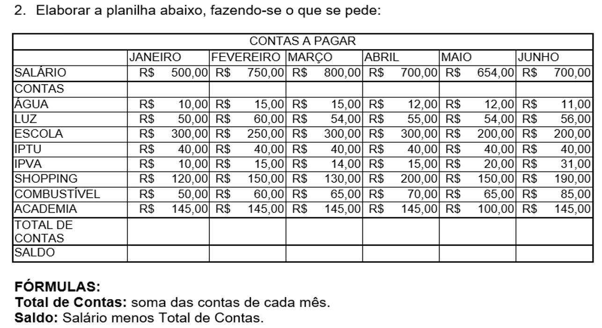
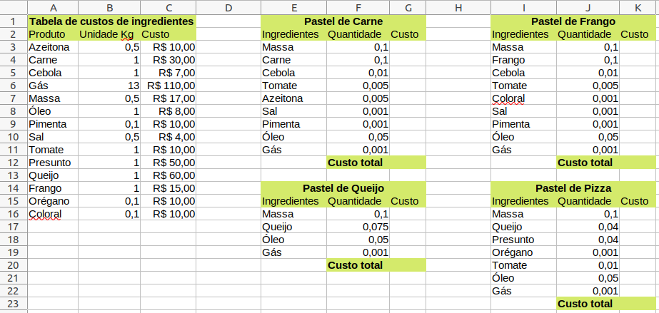

# Aula03 - Desafios

## Desafio Nº 01
### Contextualização
Sempre é bom ter uma noção de como fazer um orçamento doméstico simples, a planilha a seguir é um exemplo de um orçamento do ano de 2006 quando o sálário mínimo era aproximadamente R$ 350,00
### Desafio
Abra uma nova planilha do Excel e digite a seguinte planilha
 

## Desafio Nº 02
### Contextualização
Vamos analizar os dados de um pequeno negócio (Barraca de pasteis para uma quermesse ou até uma feira) como calcular os custos de produção de pastéis.
Este mesmo exemplo pode ser aplicado para qualquer outro negócio semelhante.
#### Conceitos
- Custo (No ponto de vista de quem compra)
- Valor (Média dos preços da região)
- Preço (No ponto de vista de quem vende)
### Desafio
Abra uma nova planilha do Excel e digite ou transcreva com uma IA (Chat GPT poe exemplo) a seguinte planilha:
 