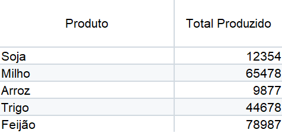
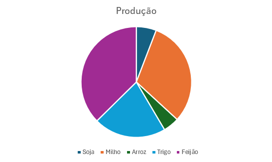
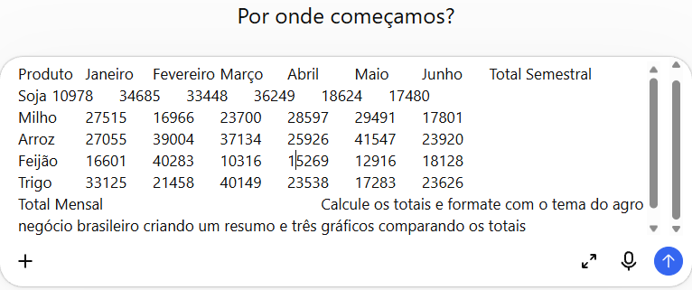
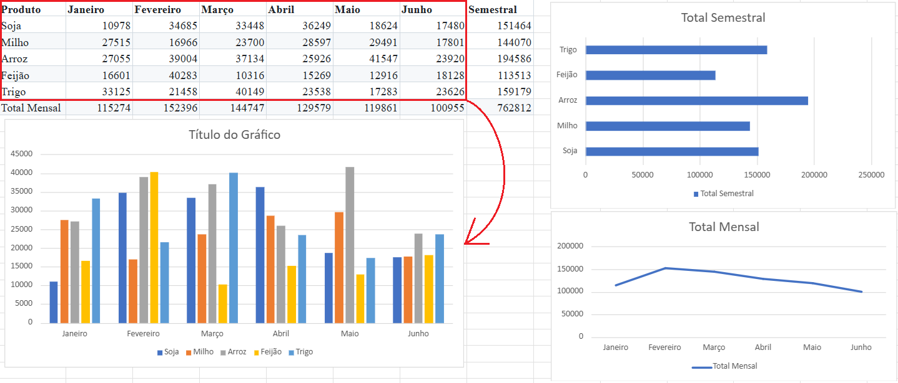
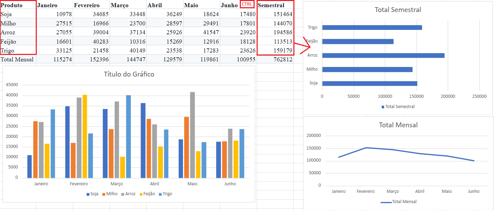
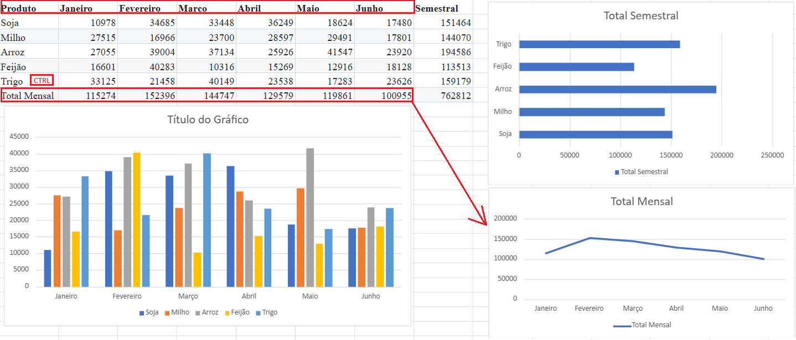

# Aula04 - Gráficos
## Atividade 01 - Um gráfico
Digite ou transcreva com IA a seguinte planilha:
<br>
## Atividade02
Selecione e crie o seguinte gráfico sugerido:
<br>
- Crie outros gráficos
    - Gráfico de colunas
    - Gráfico de barras
    - Gráfico de linhas
- OBS: Os melhores gráficos são os de colunas ou barras, pois facilitam o entendimento ao ver os dados.

## Atividade 02 - Vários gráficos
A planilha a seguir está em formato de texto, pode copiar e colar diretamente no excel e calcular os totais.

|Produto|Janeiro|Fevereiro|Março|Abril|Maio|Junho|Total Semestral|
|-|-|-|-|-|-|-|-|
|Soja|10978|34685|33448|36249|18624|17480||
|Milho|27515|16966|23700|28597|29491|17801||
|Arroz|27055|39004|37134|25926|41547|23920||
|Feijão|16601|40283|10316|15269|12916|18128||
|Trigo|33125|21458|40149|23538|17283|23626||
|Total Mensal||||||||

Podemos também colar diretamente em uma IA
- Abra uma nova Aba do navegador (Google Chrome)
    - Digite: GPT
        - Acesse o GPT Brasil
        - Cole a planilha e escreva o seguinte prompt:
```
Calcule os totais e formate com o tema do agro negócio brasileiro criando um resumo e três gráficos comparando os totais
```

- Veja o retorno e análise da IA.

## Vamos fazer nossa análize manual
Criar vários gráficos com esta planilha

- Selecionando somente os dados sem os totais

- Selecionando a coluna de produtos e com o CTRL pressionado a coluna total semestral

- Selecionando a primeira linha e a última sem o total


