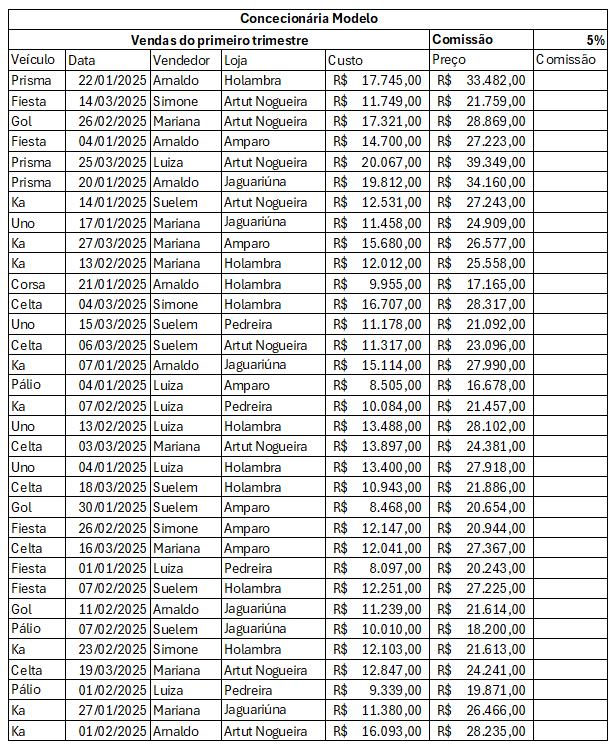

## Atividade 03
A partir da planilha a seguir, calcule a comissão e faça um gráfico comparando o vendedor com a maior comissão e o vendedor com a menor comissão

### Entrega
Copie o gráfico e envie para o email do professor