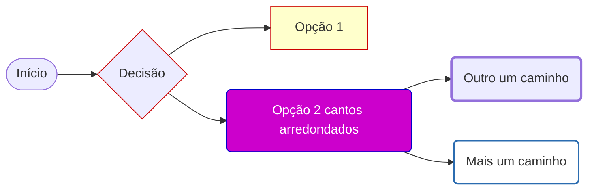
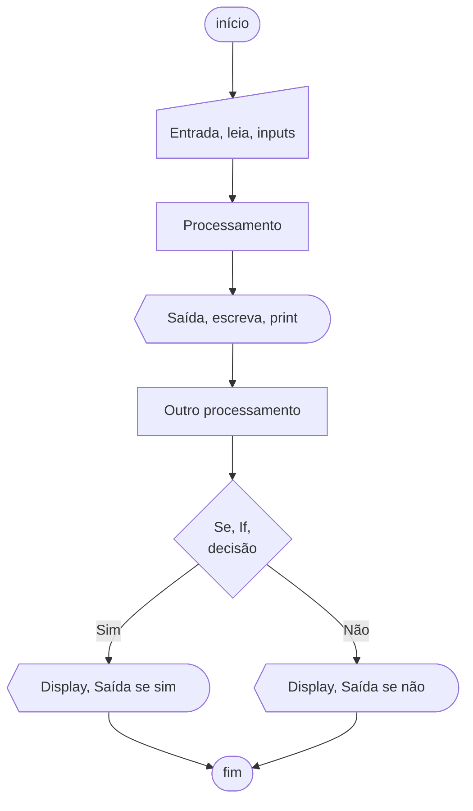
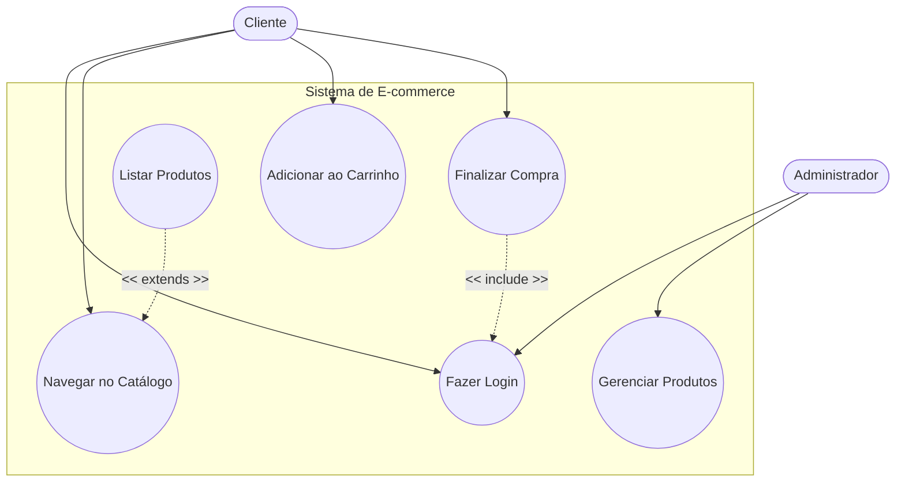

# Mermaid

## Mapa mental

## Fluxograma


## UML - DCU
UML(Unified Modeling Language), DCU(Diagrama de Casos de Uso)

Caso beta
```mermaid
usecase-beta
    actor Cliente
    actor Admin as "Administrador"

    systemBoundary Sistema["Loja Online"] {
        usecase UC1("Fazer Pedido")
        usecase UC2("Realizar Pagamento")
        usecase UC3("Gerenciar Estoque")
    }

    Cliente --> UC1
    UC1 ..> UC2 : include
    Admin --> UC3
```