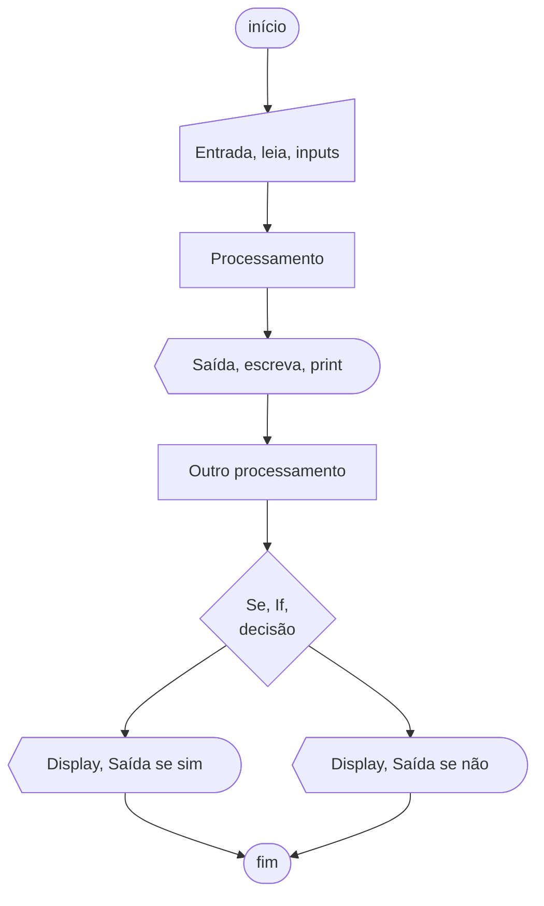

# Mermaid

## Mapa mental
```mermaid
flowchart LR
    A(["Início"])
    A --> B{"Decisão"}
    B --> C["Opção 1"]
    B --> D("Opção 2 cantos arredondados")
    D --> E("Outro um caminho")
    D --> F("Mais um caminho")
    style B stroke:#cc0000
    style C stroke:#cc0000,fill:#ffffcc
    style D stroke:#0000cc,fill:#cc00cc,color:#ffffff
    style E stroke-width:3px
    style F fill:#ffffff,stroke:#2b6cb0,stroke-width:5px,filter:drop-shadow(0px 6px 8px rgba(0,0,0,0.3))
    
```
## Fluxograma

