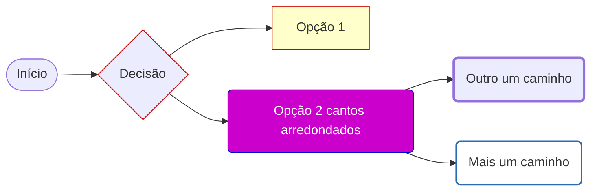
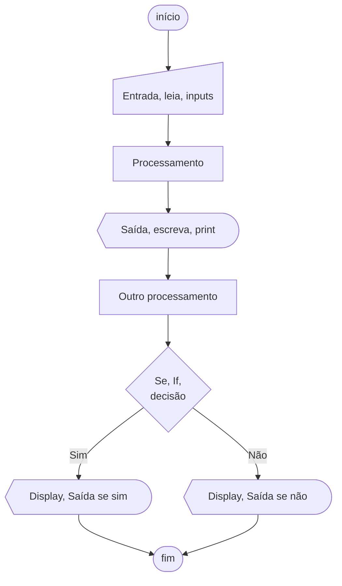
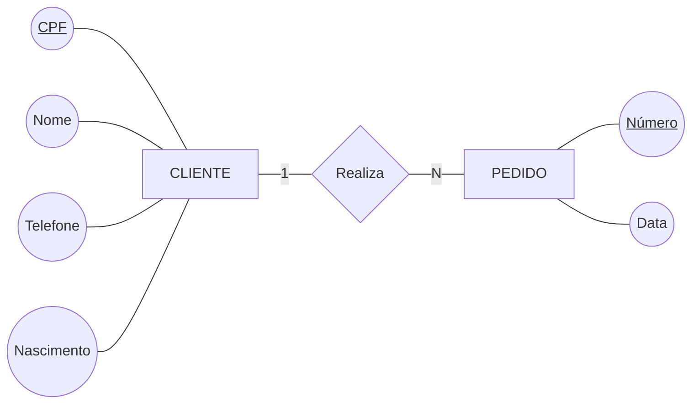
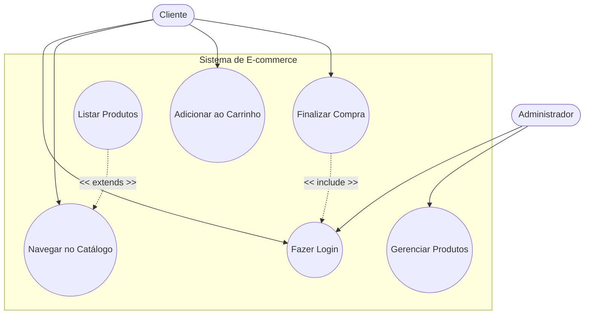
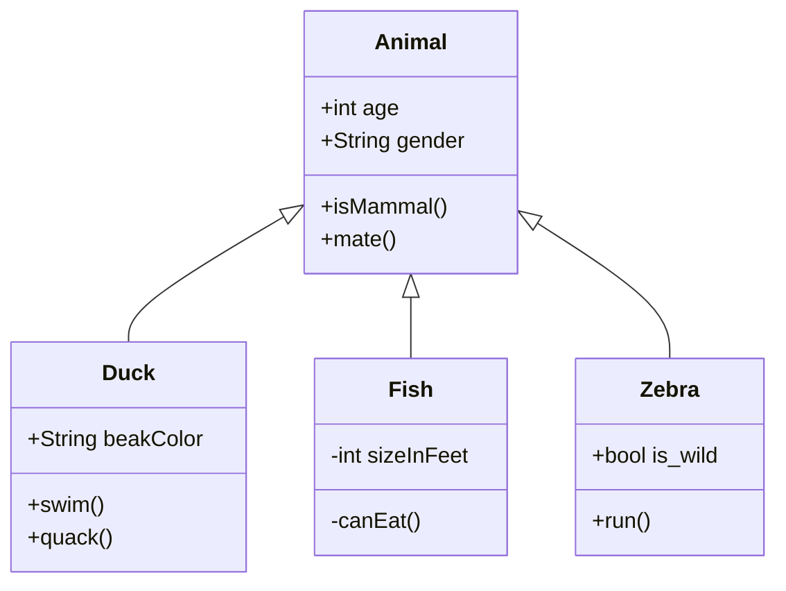

# Mermaid

## Mapa mental

## Fluxograma

## DER Conceitual

## UML - DCU
UML(Unified Modeling Language), DCU(Diagrama de Casos de Uso)

## UML - DC
UML(Unified Modeling Language), DC(Diagrama Classes)
